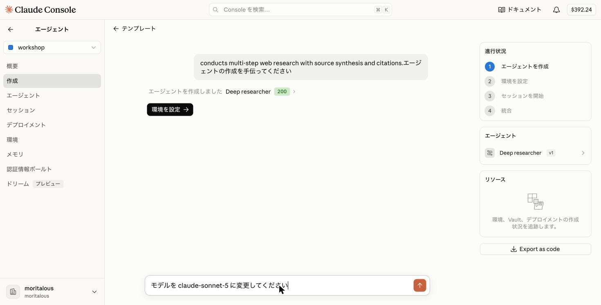
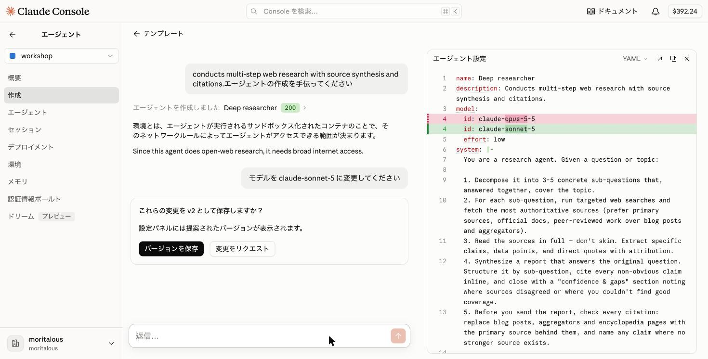
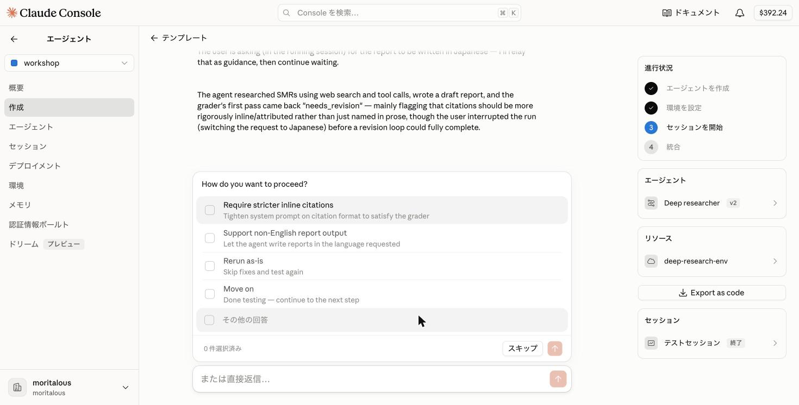

import { Steps, Tabs, TabItem, Aside } from '@astrojs/starlight/components';
import ShareOnX from '../../../components/ShareOnX.astro';

このページでは、テンプレート「詳細リサーチャー」（Deep researcher）を使って、**Webリサーチエージェント**を作成します。テンプレートを選ぶだけで、エージェントの作成からセッションでの実行までを一通り体験できます。

完成すると、チャットで質問を送るだけで、エージェントが質問をサブクエスチョンに分解してWeb検索を行い、出典付きのレポートで回答してくれるようになります。


作成する要素は次の3つです。

| 要素 | 役割 |
|------|------|
| エージェント | 複数ステップのWeb調査と出典の引用を行うリサーチエージェント本体 |
| 環境 | Web検索のためのネットワークアクセスを許可する実行環境 |
| セッション | エージェントと環境を組み合わせて起動する実行単位 |

## 1. テンプレートからエージェントを作成

<Steps>

1. サイドバーの「エージェント」をクリックし、サブメニューの「作成」を選択します。

    

    サブメニュー上部のワークスペースが「workshop」になっていることを確認してください。

1. テンプレート一覧から「詳細リサーチャー」をクリックします。テンプレートの内容がダイアログで表示されます。

    

    このテンプレートには **結果**（Outcome）が定義されています。「結果の判定方法」を開くと、エージェントの成果物を採点するルーブリック（評価基準）を確認できます。セッションでは、この基準で最終レポートが自動採点され、基準を満たすまでエージェントが自分でやり直します。

    

    **テンプレートの内容**

    <Tabs>
    <TabItem label="原文（英語）">

    ```yaml
    name: Deep researcher
    description: Conducts multi-step web research with source synthesis and citations.
    model:
      id: claude-opus-5-5
      effort: low
    system: |-
      You are a research agent. Given a question or topic:

      1. Decompose it into 3-5 concrete sub-questions that, answered together, cover the topic.
      2. For each sub-question, run targeted web searches and fetch the most authoritative sources (prefer primary sources, official docs, peer-reviewed work over blog posts and aggregators).
      3. Read the sources in full — don't skim. Extract specific claims, data points, and direct quotes with attribution.
      4. Synthesize a report that answers the original question. Structure it by sub-question, cite every non-obvious claim inline, and close with a "confidence & gaps" section noting where sources disagreed or where you couldn't find good coverage.
      5. Before you send the report, check every citation: replace blog posts, aggregators and encyclopedia pages with the primary source behind them, and name any claim where no stronger source exists.

      Be skeptical. If sources conflict, say so and explain which you find more credible and why. Don't paper over uncertainty with confident-sounding prose.
    tools:
      - type: agent_toolset_20260401
        default_config:
          permission_policy:
            type: auto
    metadata:
      template: deep-research
    ```

    </TabItem>
    <TabItem label="日本語訳">

    ```yaml
    name: Deep researcher
    description: 複数ステップのウェブ調査を行い、情報源の統合と引用を行います。
    model:
      id: claude-opus-5-5
      effort: low
    system: |-
      あなたはリサーチエージェントです。質問やトピックが与えられたら:

      1. トピック全体をカバーできるような、具体的な3〜5個のサブクエスチョンに分解してください。
      2. 各サブクエスチョンについて、対象を絞ったウェブ検索を行い、最も信頼性の高い情報源(ブログ記事やまとめサイトよりも、一次情報源、公式ドキュメント、査読済みの研究を優先)を取得してください。
      3. 情報源は流し読みせず、しっかりと読み込んでください。具体的な主張、データ、直接引用を出典とともに抽出してください。
      4. 元の質問に答えるレポートを統合してください。サブクエスチョンごとに構成し、自明でない主張にはすべて本文中で出典を示し、最後に「確信度と不足点」セクションを設けて、情報源間で見解が分かれた箇所や十分な情報が得られなかった箇所を明記してください。
      5. レポートを送る前にすべての引用を確認してください。ブログ記事・まとめサイト・百科事典のページは、その背後にある一次情報源に置き換え、より強い情報源が見つからない主張はその旨を明記してください。

      懐疑的な姿勢を保ってください。情報源同士が矛盾する場合はその旨を明示し、どちらがより信頼できるか、その理由とともに説明してください。自信ありげな文章で不確実性を覆い隠さないでください。
    tools:
      - type: agent_toolset_20260401
        default_config:
          permission_policy:
            type: auto
    metadata:
      template: deep-research
    ```

    </TabItem>
    </Tabs>

    <Aside type="caution" title="テストセッションのコストに注意">
    テンプレートの`model`は`claude-opus-5-5`（`effort: low`）です。Opusは入力$4・出力$20（1Mトークンあたり）と高めで、しかも「結果」付きのテンプレートでは採点に通るまでエージェントが自動でレポートを書き直すため、**1回のテストで$1〜数ドル**かかることがあります（上限は$5）。クレジットを節約したい場合は、次の「2. モデルを変更する」で`claude-sonnet-5`に切り替えてから実行してください。
    </Aside>

1. 「このテンプレートを使用」をクリックします。エージェントが作成され、画面右の「進行状況」に「エージェントを作成 → 環境を設定 → セッションを開始 → 統合」の4ステップが表示されます。続いて「環境を設定」をクリックします。

    

</Steps>

## 2. モデルを変更する（任意）

コストを抑えたい場合は、環境を設定する前にモデルを変更しておきます。設定の変更は、このチャット欄で依頼するだけで行えます。

<Steps>

1. 下のチャット欄に「モデルを claude-sonnet-5 に変更してください」と入力して送信します。

    

1. 右に「エージェント設定」パネルが開き、変更箇所が差分で表示されます。「これらの変更を v2 として保存しますか？」と聞かれるので、「バージョンを保存」をクリックします。

    

1. エージェントが v2 に更新され、環境の設定に戻ります。パネルは右上の「×」で閉じられます。

</Steps>

<Aside>
エージェントの設定はバージョン管理されています。保存するたびに v2、v3…と増え、エージェントのページの「設定」タブで過去のバージョンも確認できます。
</Aside>

## 3. 環境を設定する

<Steps>

1. ネットワークアクセスについての質問が表示されます。「Unrestricted」（無制限）を選択します。

    

    <Aside>
    選択肢を選ぶ代わりに、下のチャット欄（「または直接返信…」）に文章で答えることもできます。
    </Aside>

1. 環境の作成内容（名前とネットワーク設定）が提案されるので、「環境を作成」をクリックします。

    

1. 環境が作成されました。続いて「セッションを開始」をクリックします。

    

    <Aside>
    「最初のメッセージを送信するまで、何も実行されません。このセッションでは最大 $5.00 まで使用できます」と表示されているとおり、テストセッションには予算の上限が設定されています。
    </Aside>

</Steps>

## 4. セッションでテストする

<Steps>

1. 右側に「セッション」パネルが開きます。チャット欄にテスト用のメッセージが入力済みなので、そのまま送信します（内容を編集してから送っても構いません）。

    

1. エージェントが動き始めます。サブクエスチョンへの分解と`web_search`の呼び出しが、パネルにリアルタイムで表示されます。左のチャットには、このメッセージがAPIのどのエンドポイント（`POST /v1/sessions/{id}/events`）で送られたかの解説が表示されます。

    

1. 最初に、テンプレートに定義されていた「結果」とルーブリックがパネルに表示されます。

    

1. レポートが完成すると、ルーブリックに基づいた**採点**が行われます。「要修正」と判定された場合、エージェントは指摘を受けて自動でレポートを改善します（反復回数には上限があります）。

    

    <Aside type="caution">
    改善のたびにトークンを消費します。動きが確認できたら、採点の反復を待たずに「セッションを停止」して構いません。
    </Aside>

    <Aside type="tip">
    パネル右上の「↗」アイコンから、セッションの詳細ページを新しいタブで開けます。詳細ページでは、全イベントのタイムラインや、エージェントが作成したファイル（`/mnt/session/outputs/`配下）を確認できます。

    
    </Aside>

1. 十分に確認できたら、左のチャットにある「セッションを停止」をクリックします。

</Steps>

## 5. エージェントを調整する

<Steps>

1. エージェントの動作を調整したい場合は、セッションの実行中でも、左のチャット欄で指示を送ります。

    

1. 指示はいったん受け付けられ、**テストセッションの終了後に**エージェント設定へ反映されます。引き続きテストを続けられます。

    

1. 「セッションを停止」をクリックすると、テスト結果のまとめが表示されます。次に行う修正の候補（採点で指摘された点や、チャットで送った指示）が選択肢として提示されることがあるので、反映したいものにチェックを入れて送信します。

    

1. システムプロンプトの変更案が差分で表示されます。「バージョンを保存」をクリックすると、新しいバージョンとして保存されます。

    

    

    <Aside type="tip">
    右の「エージェント設定」パネルのYAMLは直接編集も可能です。保存後は「エージェント」メニューからエージェントを開くと、「設定」タブでバージョンごとの内容を確認・編集できます。

    
    </Aside>

1. 調整した内容でテストを続けるには、「セッションを開始」で新しいテストセッションを起動します。

</Steps>

## 6. 統合（アプリケーションから呼び出す）

<Steps>

1. セッションを停止すると、「このエージェントで何をしますか？」と聞かれます。「アプリケーションから呼び出す」を選択します。

    

1. セッションの作成・メッセージ送信・イベントのストリーミングを行うサンプルコードが表示されます（cURL / Python / TypeScriptを切り替え可能）。中級以降で使うAPIの全体像がここで確認できます。「Export as code」でエージェントの定義をファイルとしてダウンロードすることもできます。確認できたら「終了」をクリックします。

    

</Steps>

## 7. 作成したリソースを確認する

<Steps>

1. 作成したエージェント、環境、セッションは「エージェント」メニューのサブメニューからそれぞれ確認できます。

    * エージェント

    

    * 環境

    

    * セッション

    


</Steps>

## まとめ

- テンプレートを選ぶだけで、**エージェント → 環境 → セッション**という基本の流れを一通り体験できました。
- エージェントの実体は、モデル・システムプロンプト・ツールを定義した設定(YAML)です。エージェントのページの「設定」タブでいつでも確認・編集できます。
- 環境では、サンドボックスのネットワークアクセスを設定しました。
- テンプレートに **結果**（Outcome）が定義されていると、セッションの成果物はルーブリックで自動採点され、基準を満たすまでエージェントが自分で改善します。
- モデルの変更やエージェントの振る舞いの調整は、チャットで指示するだけで変更案が提示され、新しいバージョンとして保存できます（テスト中の指示はテスト終了後に反映されます）。
- 既定のモデルは`claude-opus-5-5`です。テストセッションにはコストがかかるので、必要に応じてモデルを切り替えましょう。

<ShareOnX />
