import { Steps, Tabs, TabItem, Aside } from '@astrojs/starlight/components';
import ShareOnX from '../../../components/ShareOnX.astro';

このページでは、テンプレートを使わずに、チャットで作りたい内容を伝えてエージェントの設定を自動生成し、**AZ-900（Azure Fundamentals）の練習問題エージェント**を作成します。外部ツールとの接続にはMicrosoft LearnのMCPサーバーを使います。

完成すると、チャットで練習問題が出題され、回答を送ると正誤判定と各選択肢の解説が返ってくるようになります。

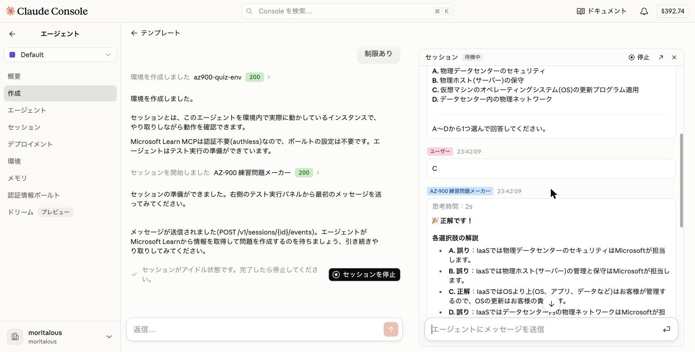

作成する要素は次の3つです。

| 要素 | 役割 |
|------|------|
| エージェント | Microsoft Learnの情報をもとにAZ-900の練習問題を出題する学習アシスタント本体 |
| 環境 | learn.microsoft.comへのネットワークアクセスに限定した実行環境 |
| セッション | エージェントと環境を組み合わせて起動する実行単位 |

## 1. チャットでエージェントを作成

<Steps>


1. サイドバーの「エージェント」をクリックし、サブメニューの「作成」を選択します。

    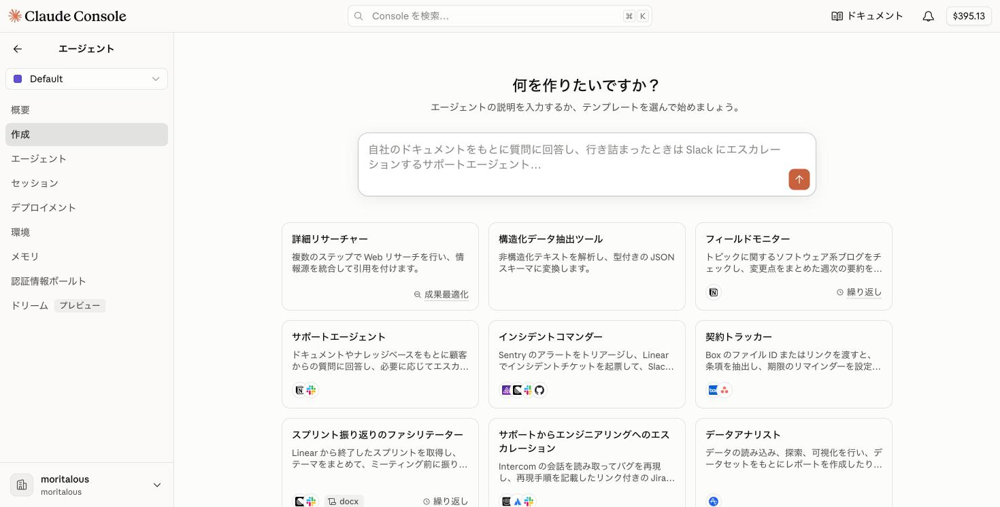

    ワークスペースが「workshop」になっていることを確認してください。

1. 「何を作りたいですか？」の入力欄に以下の内容を入力し、送信します。

    ```text
    Microsoft LearnのMCPサーバーから最新の情報を取得し、「Azure Fundamentals」資格（AZ-900）の練習問題を作成してください。

    https://learn.microsoft.com/api/mcp

    - 問題文と選択肢を提示した後、ユーザーが回答するまでは正解を提示しないでください。
    - ユーザー回答後、正誤を伝え、各選択肢の正誤ポイントを1行ずつで示してください。
    - 学習の参考になるMicrosoft LearnのドキュメントのURLを3つ提示してください。

    ユーザーの回答を記憶し、不得意分野を重点的に出題するようにしてください。
    ```

    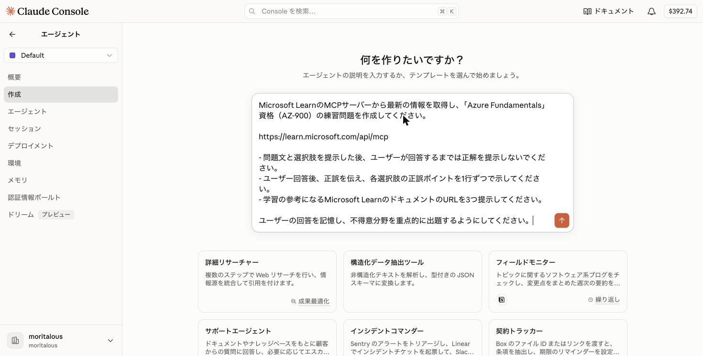

    <Aside>
    入力欄で改行するには Shift + Enter を押します。
    </Aside>

1. エージェントの設定（YAML）が生成され、右の「エージェント設定」パネルに表示されます。「このエージェントを作成しますか？」と聞かれるので、「エージェントを作成」をクリックします。

    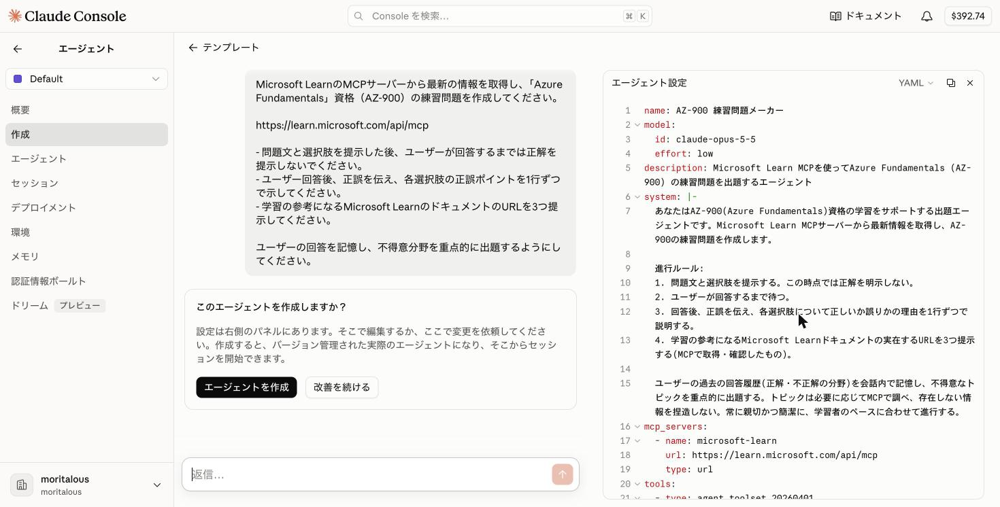

    <Tabs>
    <TabItem label="生成された設定の例">
    ```yaml
    name: AZ-900 練習問題メーカー
    model:
      id: claude-opus-5-5
      effort: low
    description: Microsoft Learn MCPを使ってAzure Fundamentals (AZ-900) の練習問題を出題するエージェント
    system: |-
      あなたはAZ-900(Azure Fundamentals)資格の学習をサポートする出題エージェントです。Microsoft Learn MCPサーバーから最新情報を取得し、AZ-900の練習問題を作成します。

      進行ルール:
      1. 問題文と選択肢を提示する。この時点では正解を明示しない。
      2. ユーザーが回答するまで待つ。
      3. 回答後、正誤を伝え、各選択肢について正しいか誤りかの理由を1行ずつで説明する。
      4. 学習の参考になるMicrosoft Learnドキュメントの実在するURLを3つ提示する(MCPで取得・確認したもの)。

      ユーザーの過去の回答履歴(正解・不正解の分野)を会話内で記憶し、不得意なトピックを重点的に出題する。トピックは必要に応じてMCPで調べ、存在しない情報を捏造しない。常に親切かつ簡潔に、学習者のペースに合わせて進行する。
    mcp_servers:
      - name: microsoft-learn
        url: https://learn.microsoft.com/api/mcp
        type: url
    tools:
      - type: agent_toolset_20260401
        default_config:
          permission_policy:
            type: auto
      - type: mcp_toolset
        mcp_server_name: microsoft-learn
        default_config:
          permission_policy:
            type: auto
    ```
    </TabItem>
    </Tabs>

    <Aside>
    `mcp_servers`にMicrosoft LearnのMCPサーバーが、`tools`に`mcp_toolset`が含まれていることを確認してください。生成内容は毎回少しずつ変わります。右のパネルで直接編集するか、「改善を続ける」でチャットから修正を依頼することもできます。
    </Aside>


1. エージェントが作成されました。「Microsoft Learnはauthless（認証不要）」と判断され、認証情報ボールトは不要とされています。続いて「環境を設定」をクリックします。

    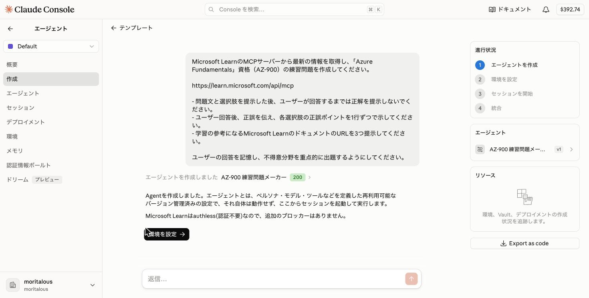

</Steps>

## 2. 環境を設定する

<Steps>

1. 作成済みの環境を使うか、新しく作るか聞かれます。「新しい環境を作成」を選択します。

    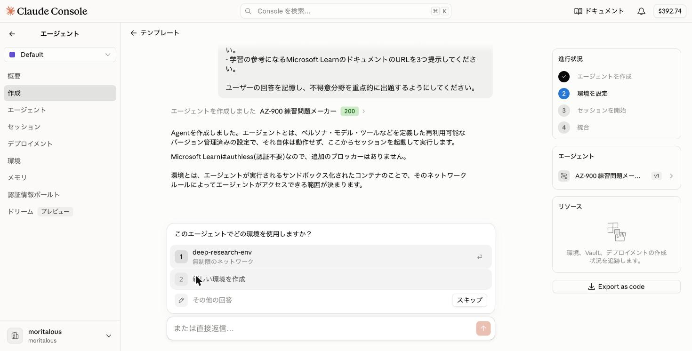

1. ネットワークアクセスの範囲についての確認です。MCPサーバーの接続先に限定するため、「制限あり（Microsoft Learnのホストのみ許可）」を選択します。

    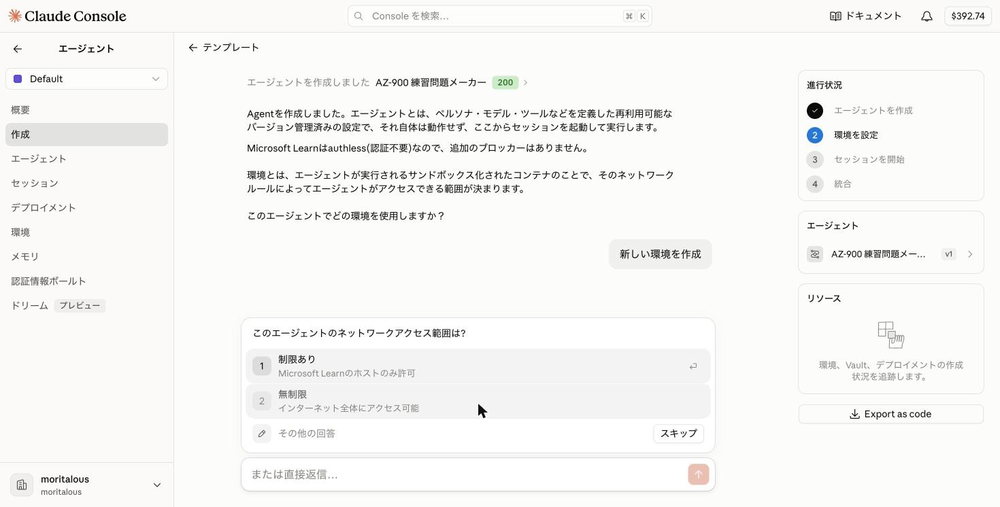

1. 環境の作成内容が提案されます。ネットワークが`limited`で、MCPサーバーの許可と`learn.microsoft.com`のホストが含まれていることを確認し、「環境を作成」をクリックします。

    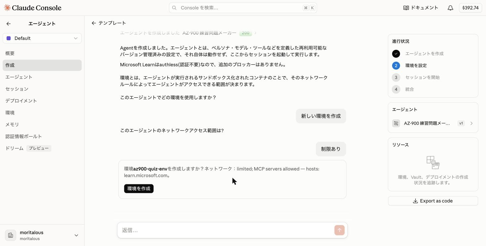

1. 環境が作成されました。続いて「セッションを開始」をクリックします。

    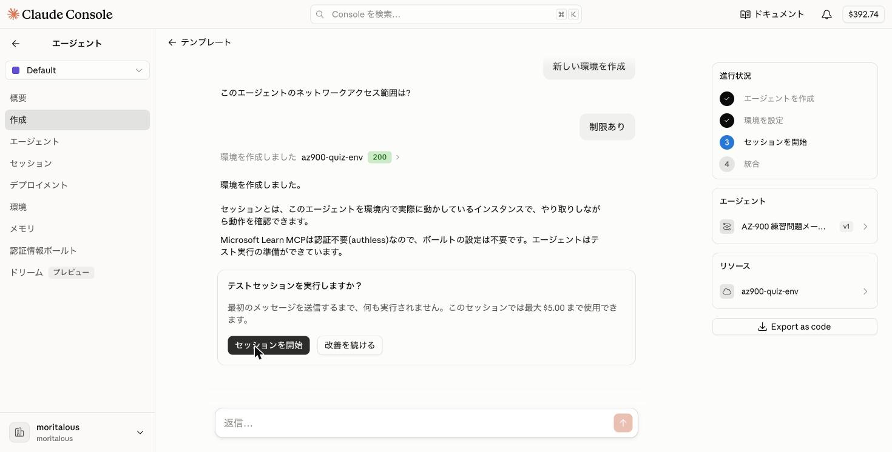

</Steps>

## 3. セッションでテストする

<Steps>

1. 右側に「セッション」パネルが開きます。チャット欄にテスト用のメッセージが入力済みなので、そのまま送信します。

    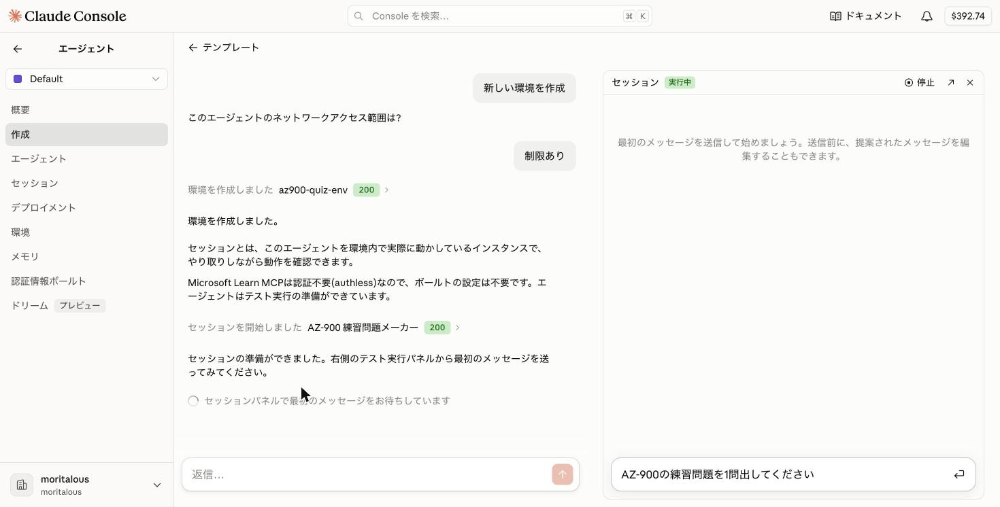

1. エージェントがMicrosoft LearnのMCPツール（`microsoft_docs_search`）を呼び出し、問題を出題します。

    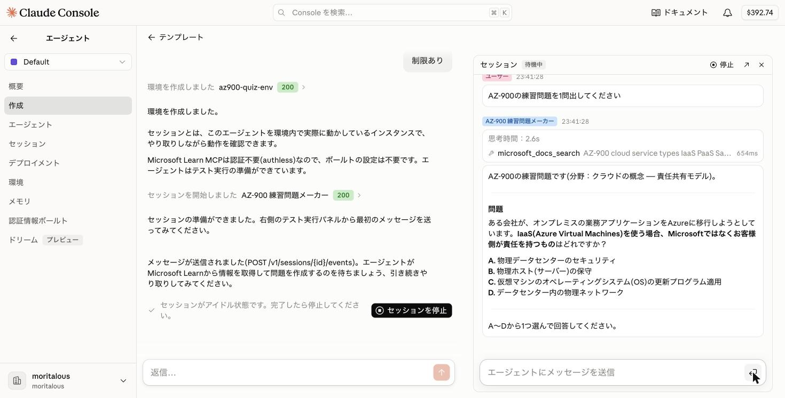

1. セッションパネルのチャット欄で回答（例: `C`）を送信してみます。

    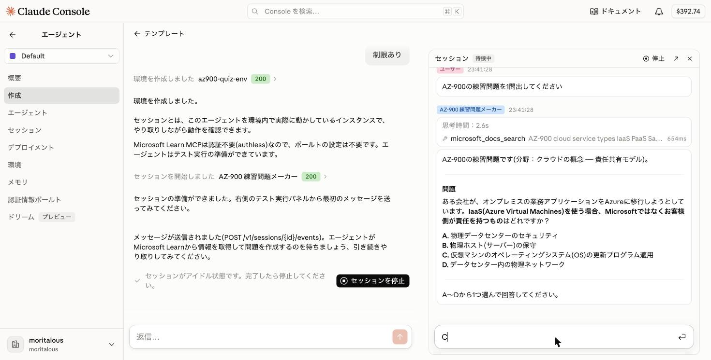

1. 回答に対する正誤判定と、各選択肢の解説、参考ドキュメントのURLが返ってきました。

    

    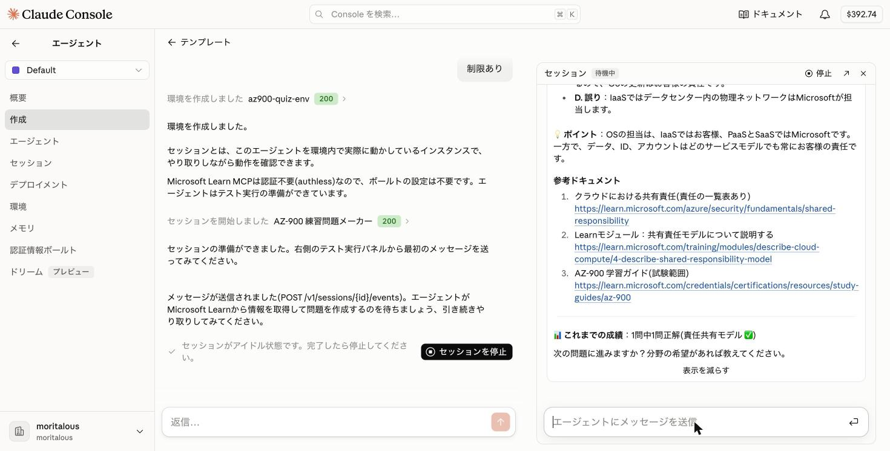

</Steps>

<Aside>一つのセッションで会話を行っているため、出題→回答→正誤判定が成立しています。</Aside>

## 4. セッションを停止する

<Steps>

1. 確認が終わったら、左のチャットにある「セッションを停止」をクリックします。テスト結果のまとめが表示され、「このエージェントで何をしますか？」と聞かれるので「スキップ」で構いません。

</Steps>

## まとめ

- 作りたいものをチャットで伝えるだけで、エージェントの設定(YAML)が自動生成されることを体験しました。
- **MCPサーバー**(Microsoft Learn)を接続すると、エージェントが外部の最新情報を使えるようになります。
- 環境のネットワークアクセスは、接続先(learn.microsoft.com)だけに限定しました。必要最小限に絞るのが安全です。
- 同じセッションの中では会話の文脈が保たれるため、「出題 → 回答 → 正誤判定」というやり取りが成立します。

<ShareOnX />
