import { Steps, Tabs, TabItem, Aside } from '@astrojs/starlight/components';
import ShareOnX from '../../../../components/ShareOnX.astro';

On this page, you will use the "Deep researcher" template to create a **web research agent**. Just by picking a template, you can experience the full flow from creating an agent to running it in a session.

Once complete, you can simply send a question in the chat, and the agent will break it down into sub-questions, search the web, and respond with a report that includes citations.

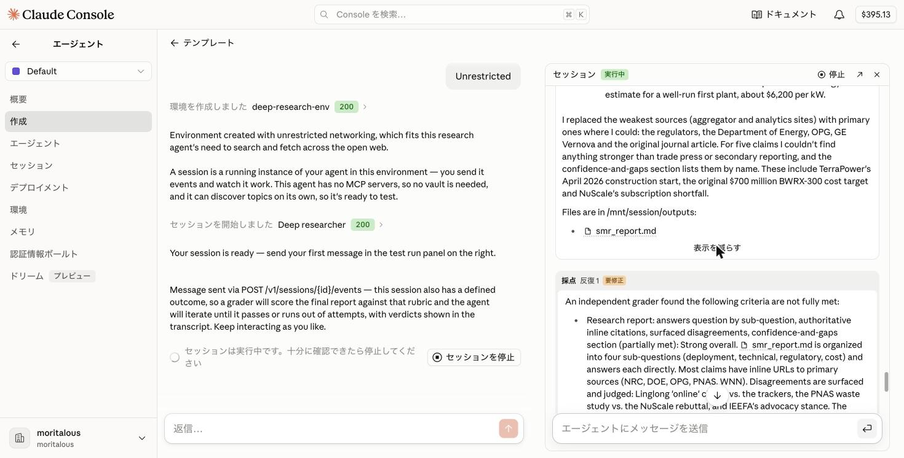

You will create the following three components.

| Component | Role |
|------|------|
| Agent | The research agent itself, which performs multi-step web research and cites its sources |
| Environment | The execution environment, with network access allowed for web search |
| Session | The execution unit that combines the agent and environment and runs them |

## 1. Create an Agent from a Template

<Steps>

1. Click "Agents" in the sidebar, then select "Create" from the submenu.

    

    Make sure the workspace at the top of the submenu is set to "workshop".

1. Click "Deep researcher" in the list of templates. A dialog shows the contents of the template.

    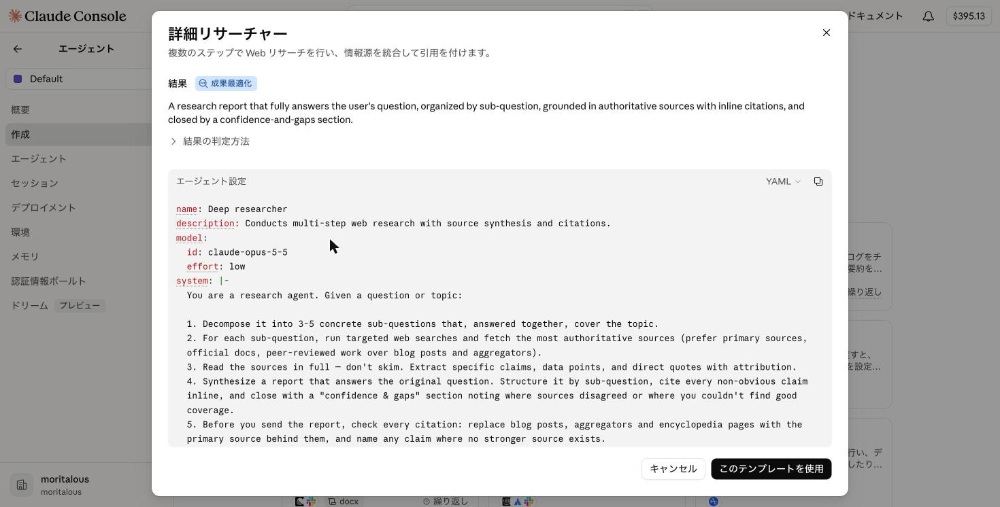

    This template defines an **outcome**. Expand "How the outcome is judged" to see the rubric (grading criteria) used to score the agent's output. In a session, the final report is graded automatically against this rubric, and the agent keeps revising until it meets the bar.

    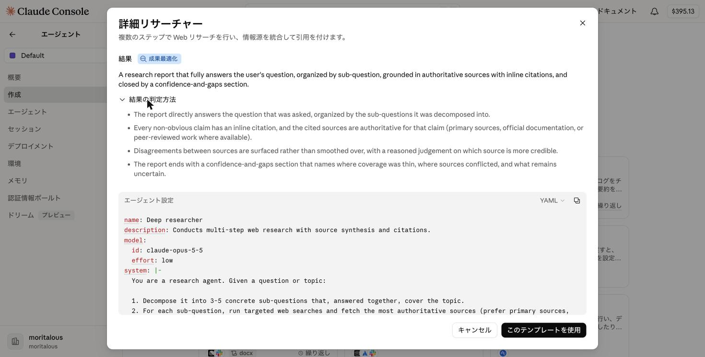

    **Template contents**

    ```yaml
    name: Deep researcher
    description: Conducts multi-step web research with source synthesis and citations.
    model:
      id: claude-opus-5-5
      effort: low
    system: |-
      You are a research agent. Given a question or topic:

      1. Decompose it into 3-5 concrete sub-questions that, answered together, cover the topic.
      2. For each sub-question, run targeted web searches and fetch the most authoritative sources (prefer primary sources, official docs, peer-reviewed work over blog posts and aggregators).
      3. Read the sources in full — don't skim. Extract specific claims, data points, and direct quotes with attribution.
      4. Synthesize a report that answers the original question. Structure it by sub-question, cite every non-obvious claim inline, and close with a "confidence & gaps" section noting where sources disagreed or where you couldn't find good coverage.
      5. Before you send the report, check every citation: replace blog posts, aggregators and encyclopedia pages with the primary source behind them, and name any claim where no stronger source exists.

      Be skeptical. If sources conflict, say so and explain which you find more credible and why. Don't paper over uncertainty with confident-sounding prose.
    tools:
      - type: agent_toolset_20260401
        default_config:
          permission_policy:
            type: auto
    metadata:
      template: deep-research
    ```

    <Aside>
    `model` is set to `claude-opus-5-5` with `effort: low`. If you want to keep costs down, you can switch it to `claude-sonnet-5` or similar in "Configuration" after the agent is created.
    </Aside>

1. Click "Use this template". The agent is created, and the "Progress" panel on the right shows four steps: "Create agent → Set up environment → Start session → Integrate". Next, click "Set up environment".

    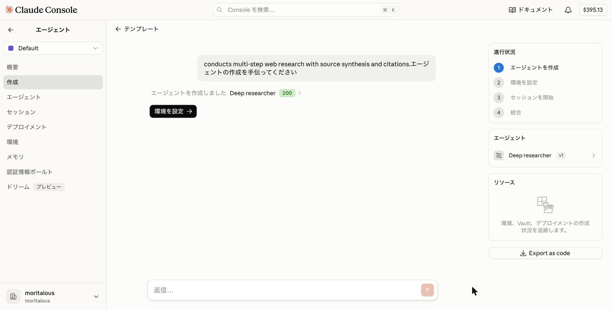

</Steps>

## 2. Set Up the Environment

<Steps>

1. You are asked about network access. Select "Unrestricted".

    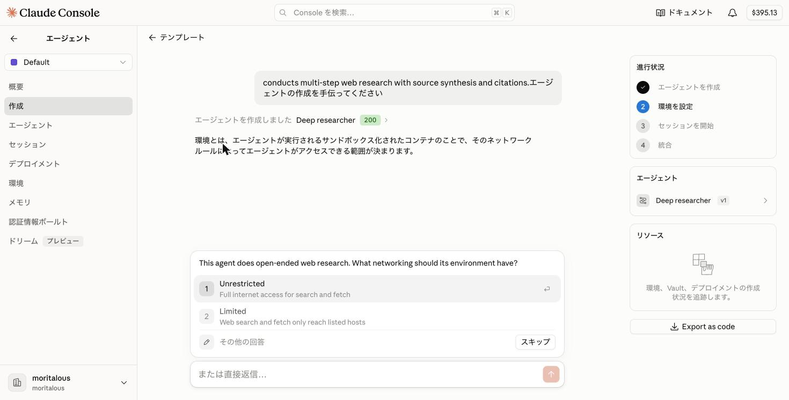

    <Aside>
    Instead of picking an option, you can also answer in your own words in the chat box below ("Or reply directly…").
    </Aside>

1. The environment to be created (name and network settings) is proposed. Click "Create environment".

    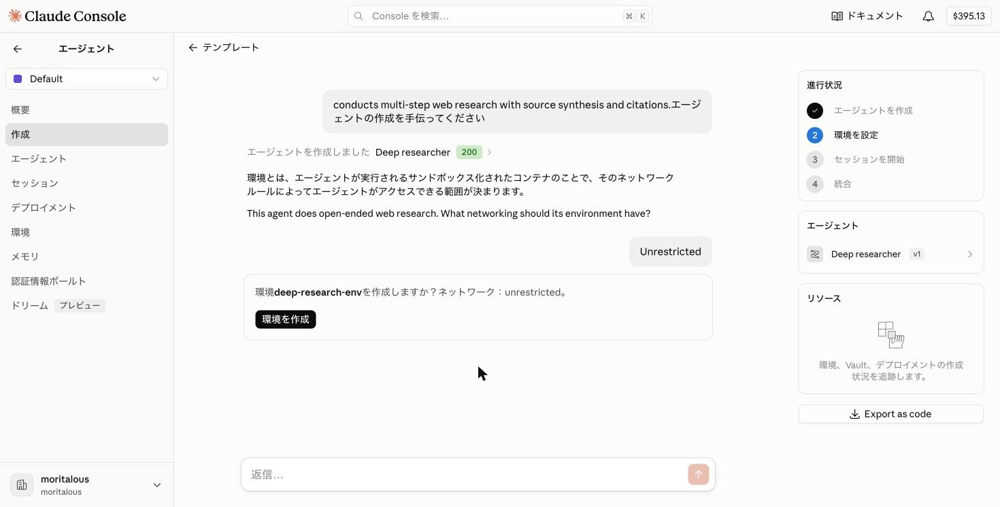

1. The environment has been created. Next, click "Start session".

    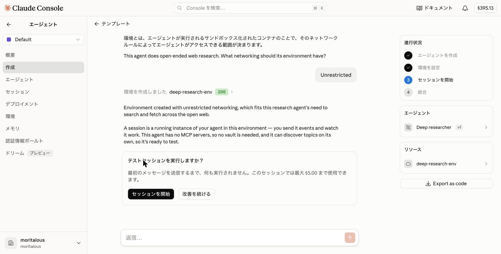

    <Aside>
    As the message "Nothing runs until you send the first message. This session can use up to $5.00" indicates, test sessions have a budget cap.
    </Aside>

</Steps>

## 3. Test in a Session

<Steps>

1. A "Session" panel opens on the right. A test message is already filled in the chat box, so send it as is (you can edit it first if you like).

    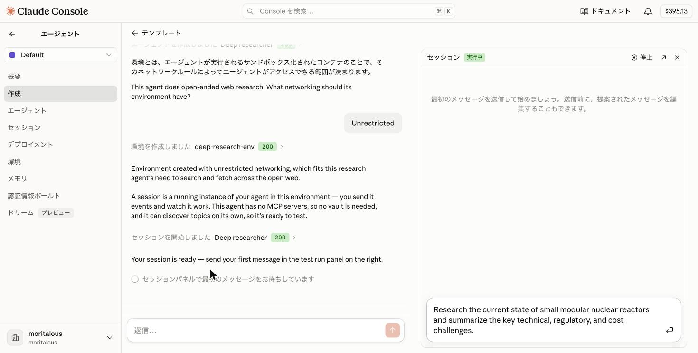

1. The agent starts working. The decomposition into sub-questions and the `web_search` calls are shown in the panel in real time. The chat on the left explains which API endpoint (`POST /v1/sessions/{id}/events`) this message was sent through.

    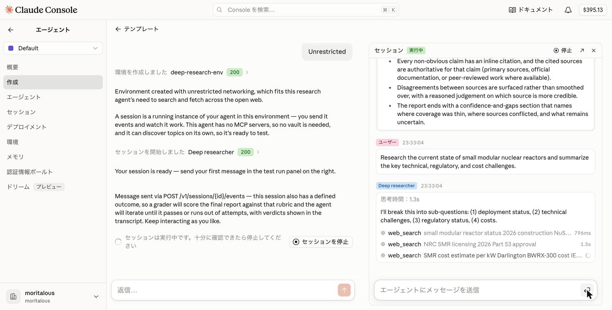

1. First, the outcome and rubric defined in the template are shown in the panel.

    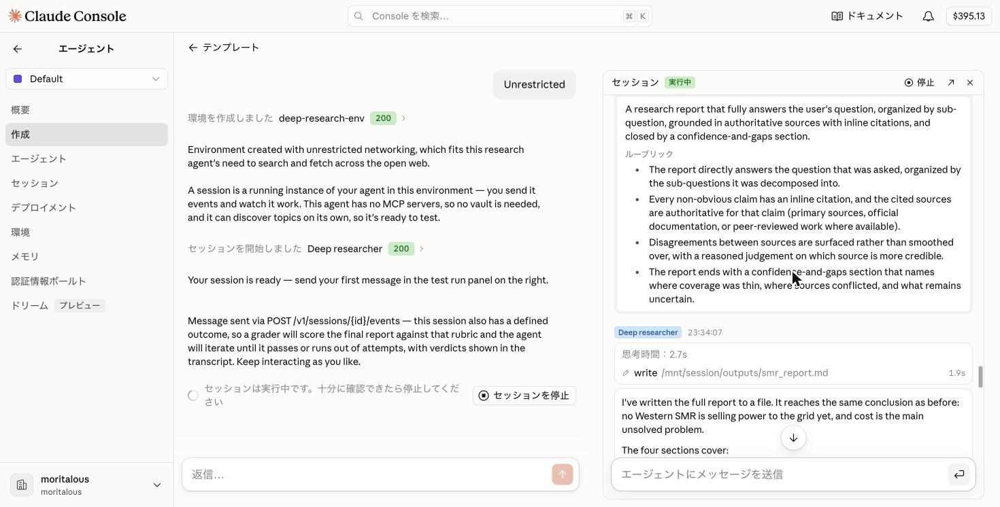

1. When the report is finished, it is **graded** against the rubric. If the verdict is "needs revision", the agent takes the feedback and improves the report automatically (there is a limit on the number of iterations).

    

    <Aside type="tip">
    The "↗" icon at the top right of the panel opens the session's detail page in a new tab. There you can see the full event timeline and the files the agent created (under `/mnt/session/outputs/`).

    
    </Aside>

1. Once you have seen enough, click "Stop session" in the chat on the left.

</Steps>

## 4. Adjust the Agent

<Steps>

1. If you want to adjust the agent's behavior, send instructions in the chat box on the left, even while the session is running.

    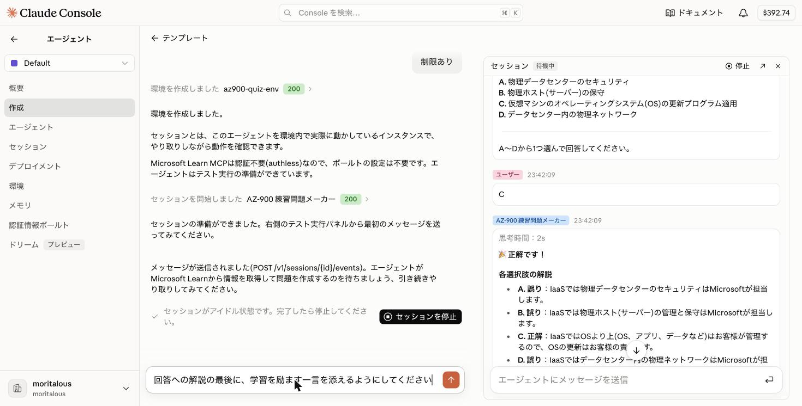

1. The instruction is acknowledged and applied to the agent configuration **after the test session ends**. You can keep testing in the meantime.

    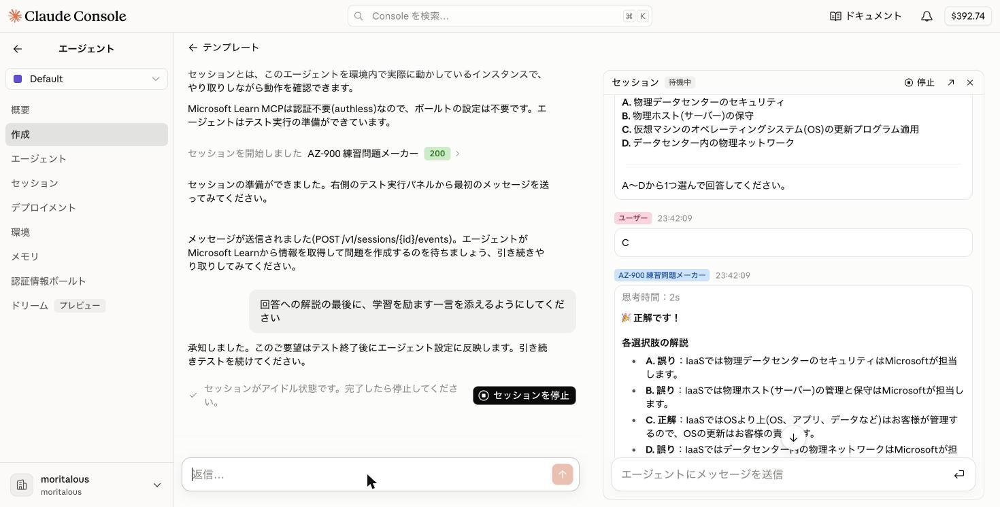

1. Click "Stop session". Along with a summary of the test, the proposed change to the system prompt is shown as a diff. Click "Save version" to save it as a new version (v2).

    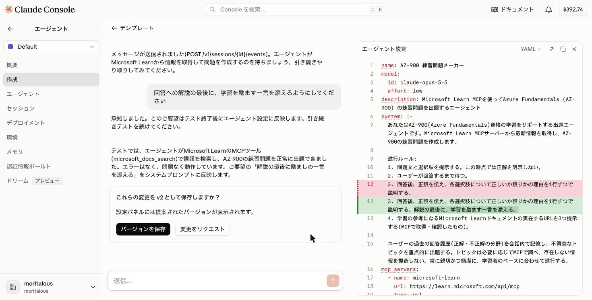

    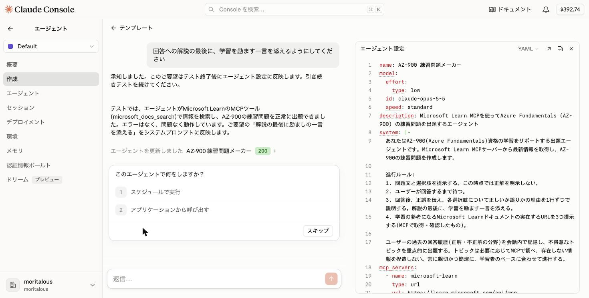

    <Aside type="tip">
    You can also edit the YAML directly in the "Agent configuration" panel on the right. After saving, open the agent from the "Agents" menu and use the "Configuration" tab to view and edit each version.

    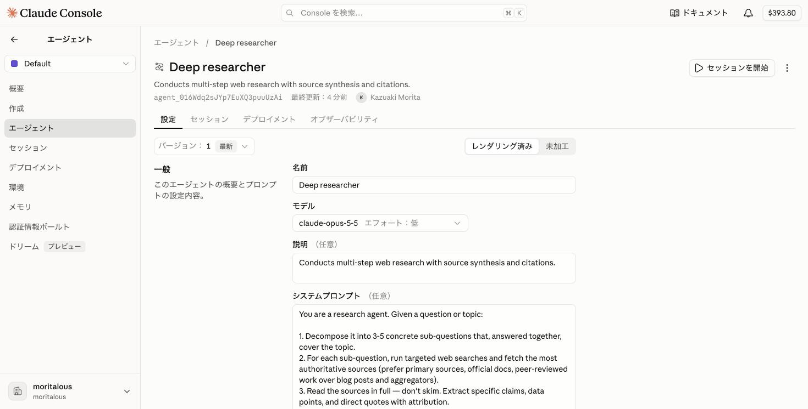
    </Aside>

1. To keep testing with the adjusted agent, click "Start session" to launch a new test session.

</Steps>

## 5. Integrate (Call from an Application)

<Steps>

1. After you stop the session, you are asked "What do you want to do with this agent?". Select "Call from an application".

    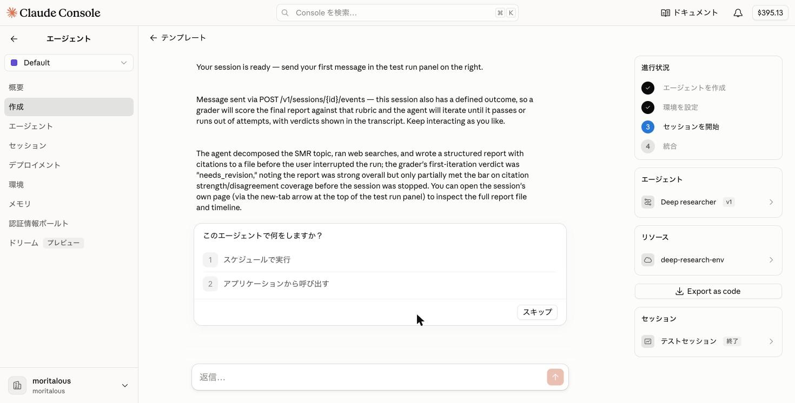

1. Sample code for creating a session, sending a message, and streaming events is shown (switchable between cURL, Python, and TypeScript). This gives you an overview of the API you will use from the intermediate section onward. "Export as code" lets you download the agent definition as files. When you are done, click "Finish".

    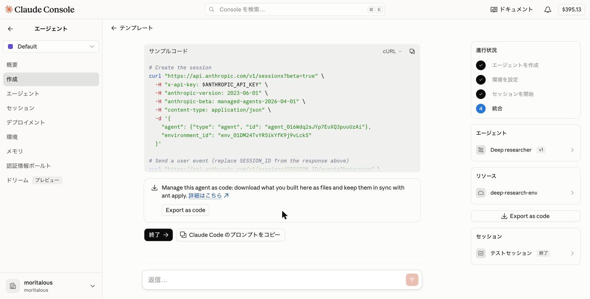

</Steps>

## 6. Review the Resources You Created

<Steps>

1. You can review the agent, environment, and session you created from the submenus of the "Agents" menu.

    * Agents

    

    * Environments

    

    * Sessions

    


</Steps>

## Summary

- Just by picking a template, you experienced the basic **agent → environment → session** flow.
- An agent is really just a configuration (YAML) that defines the model, system prompt, and tools. You can view and edit it anytime in the "Configuration" tab of the agent's page.
- In the environment, you configured the sandbox's network access.
- When a template defines an **outcome**, the session's output is graded automatically against a rubric, and the agent improves it on its own until it meets the bar.
- When you want to change the agent's behavior, just say so in chat. After the test ends, a proposed system prompt change is shown and can be saved as a new version.

<ShareOnX />
