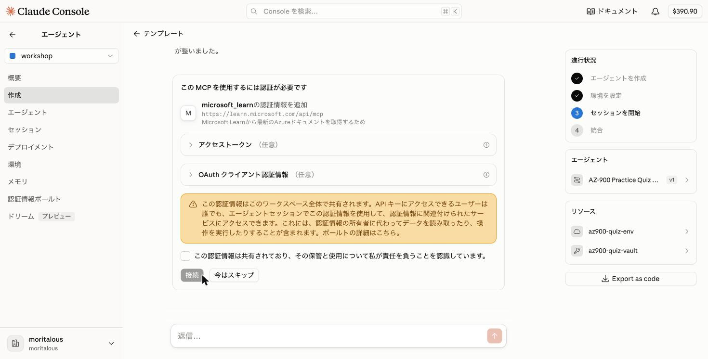
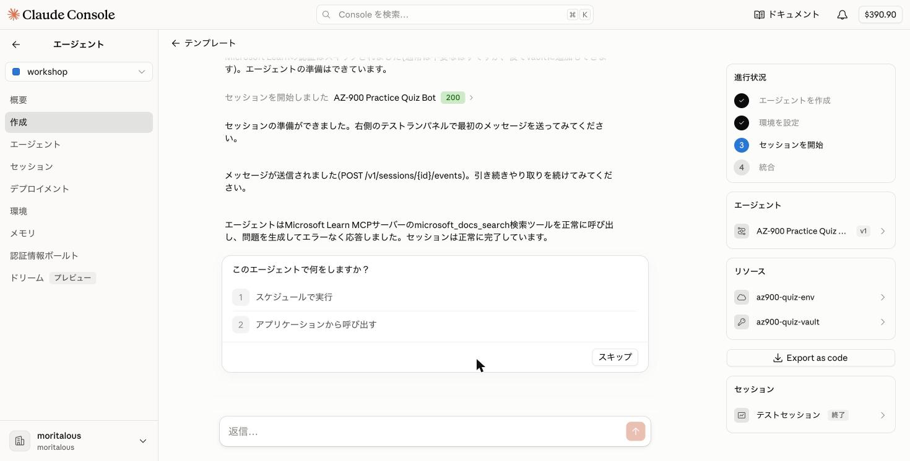

import { Steps, Tabs, TabItem, Aside } from '@astrojs/starlight/components';
import ShareOnX from '../../../../components/ShareOnX.astro';

On this page, instead of using a template, you describe what you want in chat to auto-generate the agent configuration, and build an **AZ-900 (Azure Fundamentals) practice-question agent**. The Microsoft Learn MCP server is used to connect to external tools.

Once complete, the agent asks practice questions in chat, and when you send an answer it returns a verdict and an explanation for each option.


You will create the following three components.

| Component | Role |
|------|------|
| Agent | The study assistant itself, which asks AZ-900 practice questions based on Microsoft Learn content |
| Environment | An execution environment whose network access is limited to learn.microsoft.com |
| Session | The execution unit that combines the agent and environment and runs them |

## 1. Create an Agent via Chat

<Steps>


1. Click "Agents" in the sidebar, then select "Create" from the submenu.

    

    Make sure the workspace is set to "workshop".

1. Enter the following in the "What do you want to build?" box and send it.

    ```text
    Fetch the latest information from the Microsoft Learn MCP server and create practice questions for the "Azure Fundamentals" certification (AZ-900).

    https://learn.microsoft.com/api/mcp

    - After presenting the question and the options, do not reveal the correct answer until the user responds.
    - After the user answers, state whether they were right, and give a one-line explanation of why each option is correct or incorrect.
    - Provide three Microsoft Learn documentation URLs that are useful for further study.

    Remember the user's answers and focus on their weaker areas.
    ```

    

    <Aside>
    Press Shift + Enter to insert a line break in the input box.
    </Aside>

1. The agent configuration (YAML) is generated and shown in the "Agent configuration" panel on the right. When asked "Create this agent?", click "Create agent".

    

    <Tabs>
    <TabItem label="Example of the generated configuration">
    ```yaml
    name: AZ-900 Practice Question Maker
    model:
      id: claude-opus-5-5
      effort: low
    description: An agent that asks Azure Fundamentals (AZ-900) practice questions using the Microsoft Learn MCP server
    system: |-
      You are a question-setting agent that supports study for the AZ-900 (Azure Fundamentals) certification. Fetch the latest information from the Microsoft Learn MCP server and create AZ-900 practice questions.

      Rules:
      1. Present the question and the options. Do not reveal the correct answer at this point.
      2. Wait until the user answers.
      3. After the answer, say whether it was correct, and explain in one line why each option is right or wrong.
      4. Provide three real Microsoft Learn documentation URLs (fetched and verified via MCP) that are useful for study.

      Remember the user's answer history (correct/incorrect by topic) within the conversation and focus on weaker topics. Look topics up via MCP as needed and never fabricate information. Always be friendly and concise, and go at the learner's pace.
    mcp_servers:
      - name: microsoft-learn
        url: https://learn.microsoft.com/api/mcp
        type: url
    tools:
      - type: agent_toolset_20260401
        default_config:
          permission_policy:
            type: auto
      - type: mcp_toolset
        mcp_server_name: microsoft-learn
        default_config:
          permission_policy:
            type: auto
    ```
    </TabItem>
    </Tabs>

    <Aside>
    Make sure `mcp_servers` contains the Microsoft Learn MCP server and `tools` contains an `mcp_toolset`. The generated content varies slightly each time. You can edit it directly in the panel on the right, or ask for changes in chat via "Keep refining".
    </Aside>


1. The agent has been created. Microsoft Learn is detected as "authless", so no credential vault is needed. Next, click "Set up environment".

    

</Steps>

## 2. Set Up the Environment

<Steps>

1. You are asked whether to reuse an existing environment or create a new one. Select "Create a new environment".

    

1. You are asked about the scope of network access. To restrict it to the MCP server's host, select "Limited (only allow Microsoft Learn hosts)".

    

1. The environment to be created is proposed. Check that networking is `limited`, that MCP servers are allowed, and that the host `learn.microsoft.com` is included, then click "Create environment".

    

1. The environment has been created. Next, click "Start session".

    

    <Aside>
    After the environment is created, a vault may be created automatically and you may be asked to add credentials with "Authentication is required to use this MCP". The Microsoft Learn MCP server needs no authentication, so click "Skip for now" and continue.

    
    </Aside>

</Steps>

## 3. Test in a Session

<Steps>

1. A "Session" panel opens on the right. A test message is already filled in the chat box, so send it as is.

    

1. The agent calls the Microsoft Learn MCP tool (`microsoft_docs_search`) and asks a question.

    

1. Send an answer (for example `C`) in the session panel's chat box.

    

1. You get a verdict on your answer, an explanation for each option, and reference documentation URLs.

    

    

</Steps>

<Aside>Because the conversation happens in a single session, the question → answer → verdict flow works.</Aside>

## 4. Stop the Session

<Steps>

1. When you are done, click "Stop session" in the chat on the left. A summary of the test is shown and you are asked "What do you want to do with this agent?"; "Skip" is fine here.

    

</Steps>

## Summary

- You experienced how an agent configuration (YAML) is auto-generated just by describing what you want in chat.
- Connecting an **MCP server** (Microsoft Learn) lets the agent use up-to-date external information.
- The environment's network access was limited to just the destination (learn.microsoft.com). Keeping it to the minimum necessary is the safe choice.
- Because the conversation context is preserved within a session, the "question → answer → verdict" exchange works.

<ShareOnX />
