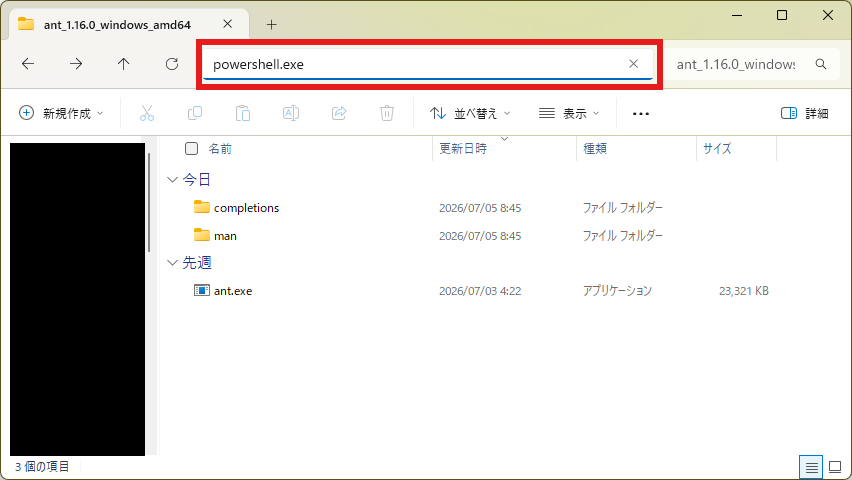
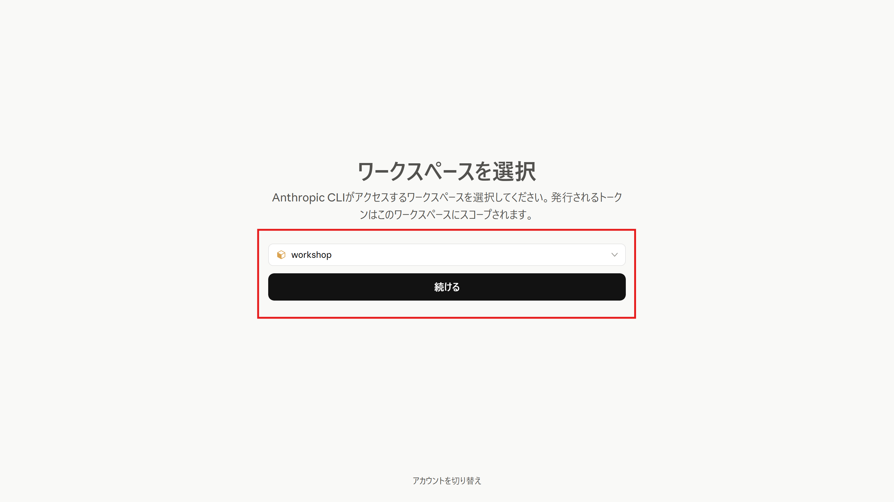

import { Steps, Tabs, TabItem, Aside } from '@astrojs/starlight/components';
import ShareOnX from '../../../../components/ShareOnX.astro';

In this section, we will create an agent using `ant`, the Claude Platform CLI. We will recreate the same setup you built from the UI in [1. Create an Agent in the Console](/en/intermediate-lite/01_console/) (environment → agent → session), entirely with `ant` commands.

<Aside>
Every command on this page starts with `beta:`, as in `ant beta:agents create`. The Managed Agents API is currently offered as a **beta**, and `ant` distinguishes beta APIs as commands with a `beta:` prefix. Calling a beta API normally requires the HTTP header `anthropic-beta: managed-agents-2026-04-01`, but using a `beta:`-prefixed command takes care of that—the CLI sends the corresponding header for you.
</Aside>

## 1. Set up the ant environment

<Steps>

1. Install ant.

    <Tabs syncKey="os">

    <TabItem label="Windows">
    1. From the `ant` [releases page](https://github.com/anthropics/anthropic-cli/releases/latest), download `ant_{version}_windows_amd64.zip`.
        
    1. Extract it to any location.
    1. Launch `powershell.exe` in the extracted folder.

        :::note
        The quickest way is to type it into the address bar where the file path is shown.

        
        :::
    1. Set the character encoding to UTF-8 so that non-ASCII text in command output does not get garbled.

        ```shell
        $OutputEncoding = [Console]::OutputEncoding = New-Object System.Text.UTF8Encoding $false
        ```

        :::note
        This setting is required per window. If you reopen PowerShell, run it again.
        :::
    </TabItem>

    <TabItem label="macOS">

    1. Open a terminal and run the following command.
        ```shell
        brew install anthropics/tap/ant
        ```
    </TabItem>

    </Tabs>

1. Run `ant auth login`.

    <Tabs syncKey="os">

    <TabItem label="Windows">
    1. Run the following command.
        ```shell
        ./ant auth login
        ```
    </TabItem>

    <TabItem label="macOS">

    1. Run the following command.
        ```shell
        ant auth login
        ```
    </TabItem>

    </Tabs>

1. Log in via your browser.

    

    :::note
    If the login process does not start automatically in your browser, open the URL printed in the terminal and follow the steps to log in.

    Running `ant auth login --no-browser` (`./ant auth login --no-browser` on Windows) skips launching the browser automatically and prints the URL in the terminal. After you authorize, the page displays a code—paste it back into the terminal.
    :::

</Steps>

<Aside type="caution" title="Log out when the workshop is over">
The credentials from `ant auth login` stay on your machine and **can end up being used by Claude Code**. For details, see [this blog post](https://dev.classmethod.jp/articles/claude-max-credit-balance-too-low/) (Japanese).

Once the workshop is over, log out with the following command.

<Tabs syncKey="os">

<TabItem label="Windows">
```shell
./ant auth logout
```
</TabItem>

<TabItem label="macOS">
```shell
ant auth logout
```
</TabItem>

</Tabs>

Note that the steps that follow ([3. Create an Agent with the SDK](/en/intermediate-lite/03_sdk/) and the advanced pages) also use these credentials, so **log out only after you have finished everything**. When you come back to continue later, just run `ant auth login` again.
</Aside>


## 2. Create an environment

To avoid name collisions with the console version, the CLI version's names end with "-cli".

<Aside>
Run the commands in PowerShell in the folder where you extracted `ant` on Windows, or in Terminal on macOS. Variables such as `$ENVIRONMENT_ID` disappear when you close the window, so run the following steps in the same window.
</Aside>

<Steps>

1. Create an environment that allows network access to MCP servers, and save its ID in a variable (the command is a single line).

    <Tabs syncKey="os">

    <TabItem label="Windows">
    ```shell
    $ENVIRONMENT_ID = ./ant beta:environments create --name "Quiz-environment-cli" --config '{type: cloud, networking: {type: limited, allow_mcp_servers: true}}' --transform id --raw-output
    ```
    </TabItem>

    <TabItem label="macOS">
    ```shell
    ENVIRONMENT_ID=$(ant beta:environments create --name "Quiz-environment-cli" --config '{type: cloud, networking: {type: limited, allow_mcp_servers: true}}' --transform id --raw-output)
    ```
    </TabItem>

    </Tabs>

    <Aside>
    `allow_mcp_servers: true` corresponds to the "Allow MCP servers" checkbox on the console's environment creation screen.
    </Aside>

    Print the variable and confirm it holds an ID starting with `env_`.

    <Tabs syncKey="os">

    <TabItem label="Windows">
    ```shell
    $ENVIRONMENT_ID
    ```
    </TabItem>

    <TabItem label="macOS">
    ```shell
    echo "$ENVIRONMENT_ID"
    ```
    </TabItem>

    </Tabs>

</Steps>

## 3. Create an agent

<Steps>

1. In the folder where you are running the commands, create a file named `agent.yaml` with the following contents.

    <Aside type="caution">
    Save it as "UTF-8" (Notepad's default is fine, but do not choose "UTF-8 with BOM"). Apart from the agent name, the settings are the same as the ones you created in the console.
    </Aside>

    ```yaml title="agent.yaml"
    name: AZ-900 Quiz Agent CLI
    model:
      id: claude-haiku-4-5
      speed: standard
    description: A study assistant that asks AZ-900 (Azure Fundamentals) practice questions using up-to-date information from the Microsoft Learn MCP server.
    system: |-
      You are a study assistant that creates AZ-900 (Azure Fundamentals) practice questions using the Microsoft Learn MCP server. Refer to the latest official Microsoft Learn documentation and ask multiple-choice questions one at a time.

      Rules:
      - After presenting the question and the options, do not reveal the correct answer until the user responds.
      - After the user answers, say whether they were right and give a one-line explanation of why each option is correct or incorrect.
      - Provide three real Microsoft Learn documentation URLs that are useful for further study.
      - Remember the user's previous answers (correct/incorrect, topic) within the conversation and prioritize topics they got wrong or are weak in for the next question.
      - Ask only one question at a time and keep a brisk pace.
    mcp_servers:
      - name: microsoft-learn
        type: url
        url: https://learn.microsoft.com/api/mcp
    tools:
      - type: mcp_toolset
        mcp_server_name: microsoft-learn
        default_config:
          enabled: true
          permission_policy:
            type: always_allow
    skills: []
    metadata: {}
    ```

1. Create the agent from `agent.yaml` and save its ID in a variable.

    <Tabs syncKey="os">

    <TabItem label="Windows">
    ```shell
    $AGENT_ID = Get-Content agent.yaml -Raw -Encoding UTF8 | ./ant beta:agents create --transform id --raw-output
    ```
    </TabItem>

    <TabItem label="macOS">
    ```shell
    AGENT_ID=$(ant beta:agents create --transform id --raw-output < agent.yaml)
    ```
    </TabItem>

    </Tabs>

    Print the variable and confirm it holds an ID starting with `agent_`.

    <Tabs syncKey="os">

    <TabItem label="Windows">
    ```shell
    $AGENT_ID
    ```
    </TabItem>

    <TabItem label="macOS">
    ```shell
    echo "$AGENT_ID"
    ```
    </TabItem>

    </Tabs>

</Steps>

## 4. Create a session

<Steps>

1. Confirm that both IDs saved so far are present.

    <Tabs syncKey="os">

    <TabItem label="Windows">
    ```shell
    $AGENT_ID; $ENVIRONMENT_ID
    ```
    </TabItem>

    <TabItem label="macOS">
    ```shell
    echo "$AGENT_ID"; echo "$ENVIRONMENT_ID"
    ```
    </TabItem>

    </Tabs>

    <Aside type="caution">
    If you do not see two lines, `agent_...` and `env_...`, go back to the step that created the empty variable and redo it. Running the next command with an empty variable shifts the arguments and produces an error such as "Unexpected extra arguments".
    </Aside>

1. Create a session from the agent and environment IDs, and save its ID in a variable (the command is a single line). No credential vault is needed, so `--vault-id` is omitted.

    <Tabs syncKey="os">

    <TabItem label="Windows">
    ```shell
    $SESSION_ID = ./ant beta:sessions create --agent $AGENT_ID --environment-id $ENVIRONMENT_ID --transform id --raw-output
    ```
    </TabItem>

    <TabItem label="macOS">
    ```shell
    SESSION_ID=$(ant beta:sessions create --agent "$AGENT_ID" --environment-id "$ENVIRONMENT_ID" --transform id --raw-output)
    ```
    </TabItem>

    </Tabs>

    Print the variable and confirm it holds an ID starting with `sesn_`.

    <Tabs syncKey="os">

    <TabItem label="Windows">
    ```shell
    $SESSION_ID
    ```
    </TabItem>

    <TabItem label="macOS">
    ```shell
    echo "$SESSION_ID"
    ```
    </TabItem>

    </Tabs>

    <Aside>
    The environment, agent, and session you created so far also appear in the corresponding console menus.
    </Aside>

</Steps>

## 5. Invoke the agent

<Steps>

1. Use two terminals: one receives events in real time while the other sends messages. First, in the window you have been using (**Terminal 1**), start streaming events.

    <Tabs syncKey="os">

    <TabItem label="Windows">
    ```shell
    ./ant beta:sessions:events stream --session-id $SESSION_ID --format jsonl
    ```
    </TabItem>

    <TabItem label="macOS">
    ```shell
    ant beta:sessions:events stream --session-id "$SESSION_ID" --format jsonl
    ```
    </TabItem>

    </Tabs>

    Leave the command running; it waits for events. With `--format jsonl`, each event is printed as one line of JSON.

1. Open a new window (**Terminal 2**) and prepare to send. Variables are per window, so set `$SESSION_ID` in Terminal 2 as well. Replace `YOUR_SESSION_ID` with the `sesn_` ID printed in [4. Create a session](#4-create-a-session) (scroll back in Terminal 1 to find it).

    <Tabs syncKey="os">

    <TabItem label="Windows">
    Launch a new PowerShell in the folder where you extracted `ant` and run:

    ```shell
    $OutputEncoding = [Console]::OutputEncoding = New-Object System.Text.UTF8Encoding $false
    $SESSION_ID = "YOUR_SESSION_ID"
    ```
    </TabItem>

    <TabItem label="macOS">
    Open a new Terminal and run:

    ```shell
    SESSION_ID="YOUR_SESSION_ID"
    ```
    </TabItem>

    </Tabs>

1. Send a message from Terminal 2 (the command is a single line).

    <Tabs syncKey="os">

    <TabItem label="Windows">
    ```shell
    ./ant beta:sessions:events send --session-id $SESSION_ID --event '{type: user.message, content: [{type: text, text: "Give me one AZ-900 practice question"}]}'
    ```
    </TabItem>

    <TabItem label="macOS">
    ```shell
    ant beta:sessions:events send --session-id "$SESSION_ID" --event '{type: user.message, content: [{type: text, text: "Give me one AZ-900 practice question"}]}'
    ```
    </TabItem>

    </Tabs>

    Once sent, events such as `user.message` start flowing in Terminal 1. After the MCP tool call (`agent.mcp_tool_use`), the question arrives as the `text` of an `agent.message` event. When `session.status_idle` appears, it is done.

1. Send your answer to the same session and you get a verdict. Sessions are stateful, so the agent remembers the question it just asked. Replace `C` with your own answer.

    <Tabs syncKey="os">

    <TabItem label="Windows">
    ```shell
    ./ant beta:sessions:events send --session-id $SESSION_ID --event '{type: user.message, content: [{type: text, text: "C"}]}'
    ```
    </TabItem>

    <TabItem label="macOS">
    ```shell
    ant beta:sessions:events send --session-id "$SESSION_ID" --event '{type: user.message, content: [{type: text, text: "C"}]}'
    ```
    </TabItem>

    </Tabs>

    Once you have seen the answer, press `Ctrl+C` in Terminal 1 to stop the stream.

    If you missed the output, you can check the event history. Events are printed one per line, and the `text` of the `agent.message` lines is the response.

    <Tabs syncKey="os">

    <TabItem label="Windows">
    ```shell
    ./ant --format jsonl --transform '{type,text:content.0.text}' beta:sessions:events list --session-id $SESSION_ID
    ```
    </TabItem>

    <TabItem label="macOS">
    ```shell
    ant --format jsonl --transform '{type,text:content.0.text}' beta:sessions:events list --session-id "$SESSION_ID"
    ```
    </TabItem>

    </Tabs>

1. Open the same session from the "Sessions" menu in the console to review the exchange on screen as well.

</Steps>

## Summary

- You recreated the same setup as in the console (environment → agent → session) using only `ant` commands.
- Beta APIs are called with `beta:`-prefixed commands. `--transform id --raw-output` extracts just the ID from the response, which you passed to the next command via variables.
- Configuration can be passed as a one-line flag (`--config`, `--event`) or as a YAML file (`agent.yaml`).
- You talk to a session with `events send` and watch it with `events stream` (or by listing the history). Keep sending to the same session and the question → answer → verdict conversation continues.

<ShareOnX />
