import { Steps, Tabs, TabItem, Aside } from '@astrojs/starlight/components';

まずは以下の準備を行います。

## 1. Claude Platformアカウントの作成

<Steps>

1. [platform.claude.com](https://platform.claude.com)にアクセスし、アカウントを作成します。Googleアカウントまたはメールアドレスで登録できます。

    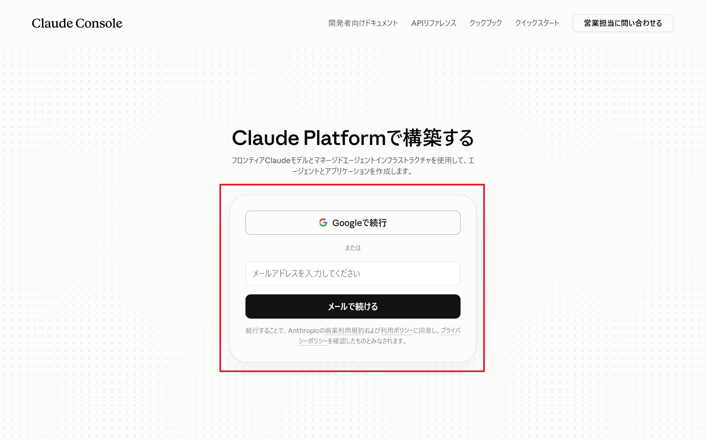

2. 名前などを入力します。

    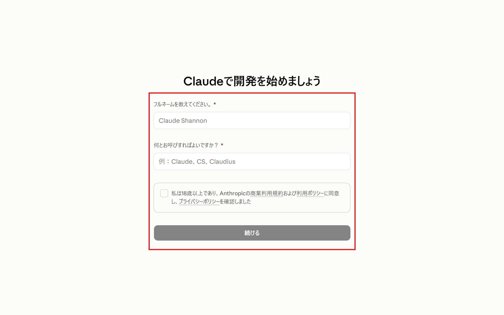

3. 「今はスキップ」を選択します。

    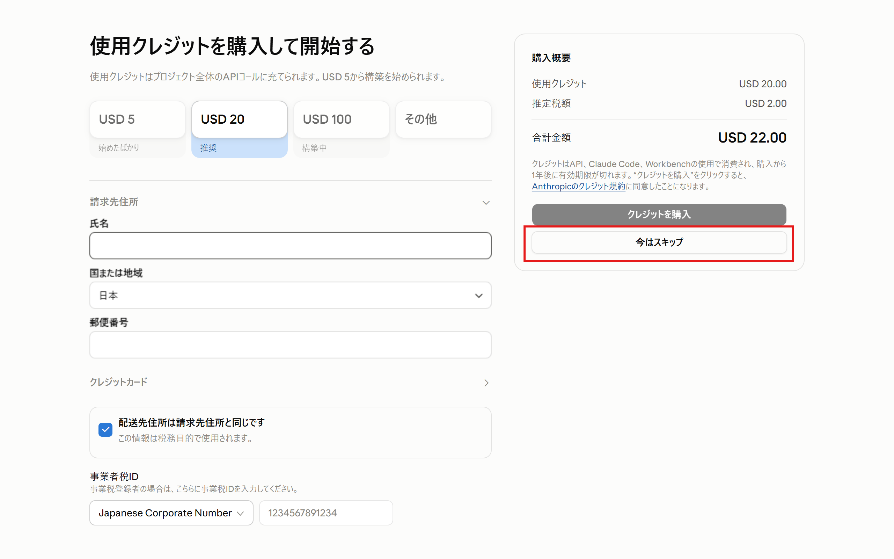

4. アカウントが作成されました。ログイン後はダッシュボードが表示されます。左のサイドバーは「構築と設定」（メッセージ・エージェント・リソース）と「組織」（支出・キーとアクセス・セキュリティとデータ・設定）の2つのグループに分かれています。

    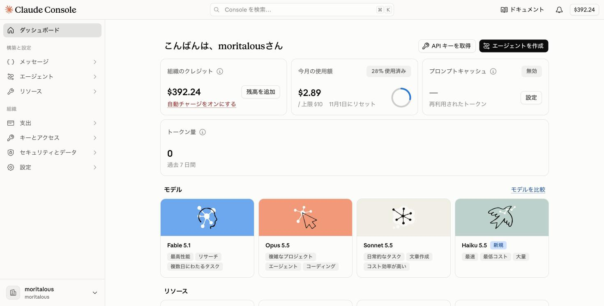

5. 表示言語は、画面左下のアカウント名をクリックして開くメニューの「言語」から変更できます。

    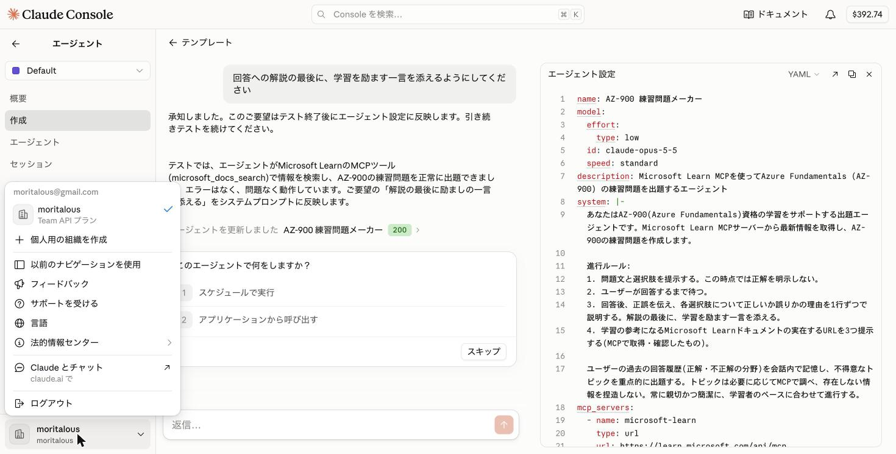

</Steps>

<Aside type="note" title="claude.aiのアカウントとは別物です">
チャットサービスの[claude.ai](https://claude.ai)のサブスクリプションアカウント（Pro/Maxプラン含む）ではAPIは利用できません。開発者向けの**Claude Platform**のアカウントが必要です。
</Aside>

## 2. APIクレジットの追加方法

Managed AgentsはAPI経由で利用するため、APIクレジット（前払いの利用枠）が必要です。

<Aside type="tip">
イベントではAPIクレジットを配布予定です。事前の購入は必須ではありません。
</Aside>

<Tabs>

<TabItem label="クレジットを購入する">

<Steps>

1. 画面右上に表示されている残高（`$0.00`など）をクリックするか、サイドバーの「支出」→「請求と支払い」を開きます。

    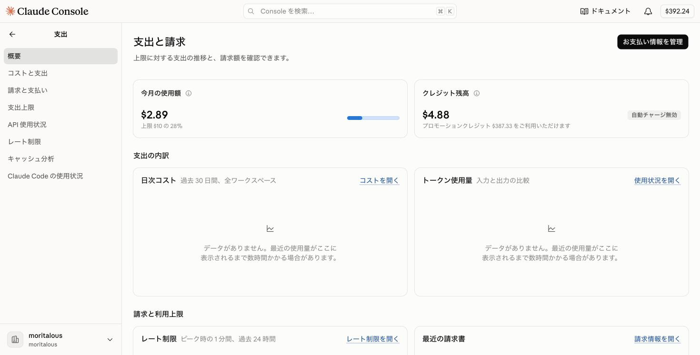

1. 「クレジット残高」の「クレジットを購入」をクリックし、クレジットカードを登録してクレジットを購入します。

    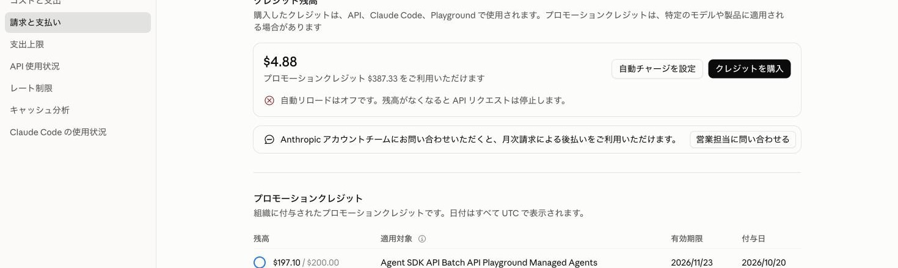

</Steps>

</TabItem>

<TabItem label="ワークショップのクレジットを使用する">

<Steps>

1. Claude Platformにログイン済みであることを確認します。

1. ワークショップ開催中に提示されるURLにアクセスします。

1. メールアドレス、組織名があっていることを確認し、氏名（First name / Last name）を入力します。「Which Anthropic products do you currently use?」で「Claude API」にチェックを入れ、「申請を送信」をクリックします。

    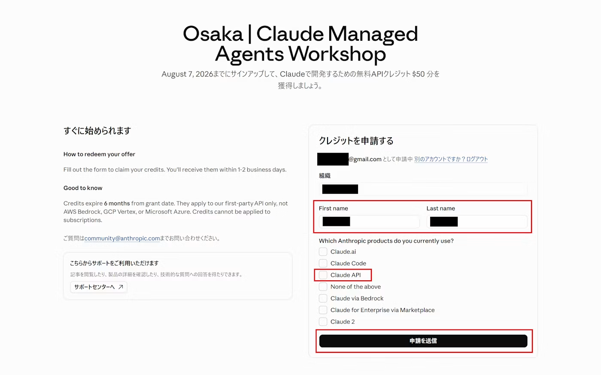

1. 完了画面が表示されます。申請が審査され、クレジットが付与されるとメールでお知らせが届きます。

    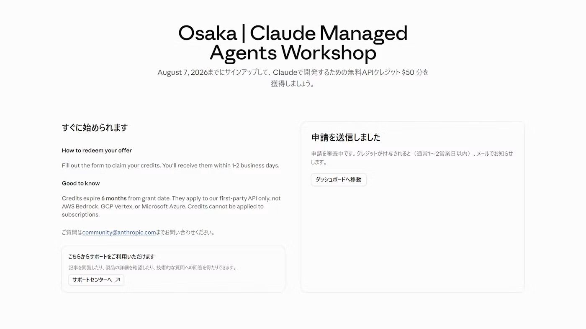

</Steps>

</TabItem>

</Tabs>

<Aside type="tip" title="ハンズオンで使う金額の目安">
ワークショップ全体を一通り実行して、**おおよそ5〜10ドル程度**が目安です（試行錯誤の回数やタスクの内容によって変わります）。初級のクイックスタートで生成されるエージェントは既定で`claude-opus-5-5`を使い、テストセッション1回あたりの上限は$5に設定されています。中級では`claude-haiku-4-5`、上級では`claude-sonnet-5`を主に使います。
</Aside>

## 3. 利用上限を設定

予期せぬ課金を防ぐため、利用上限を設定しましょう。

<Steps>

1. サイドバーの「支出」→「支出上限」を開きます。

1. 「月間支出上限」の「制限を調整」をクリックし、上限額をセットします。

    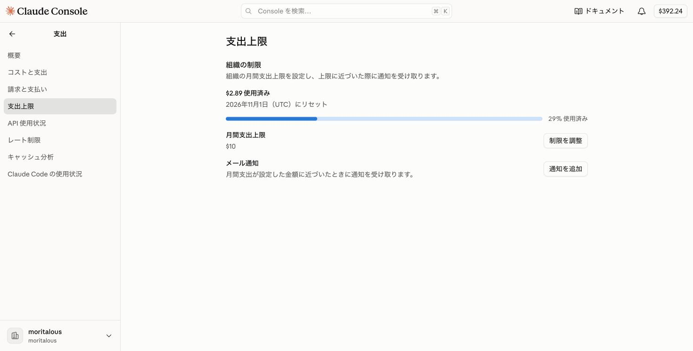

</Steps>

## 4. ワークスペースを作成

ワークスペースを作成します。

<Steps>

1. サイドバーの「設定」→「ワークスペース」を開き、「ワークスペースを作成」をクリックします。

    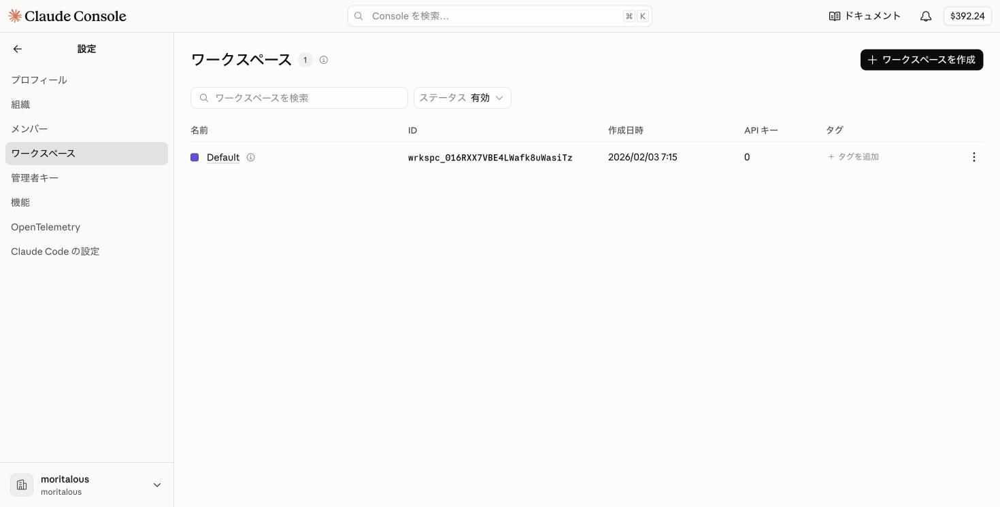

1. 名前に「workshop」と入力し、カラーを選んで「ワークスペースを作成」をクリックします。

    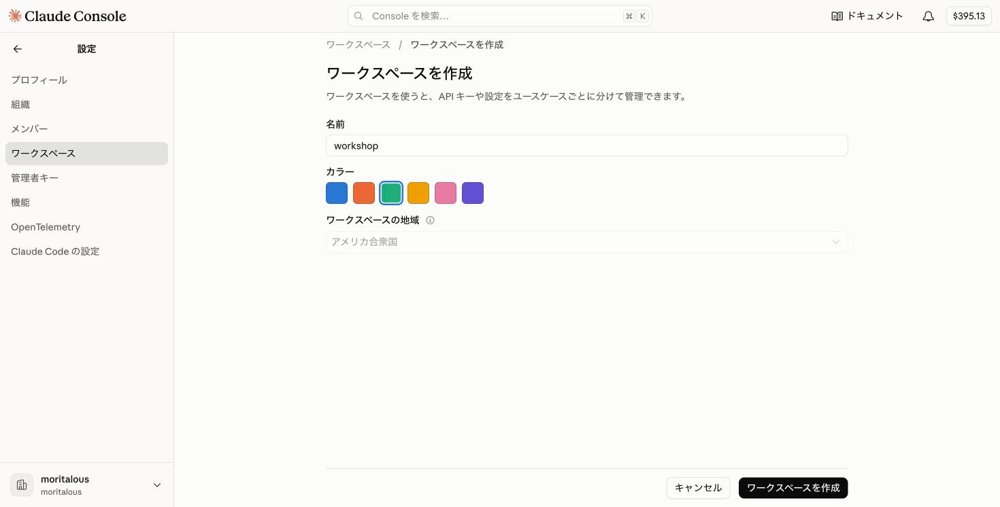

</Steps>

<Aside>
ワークスペースの切り替えは、「エージェント」などのメニューを開いたときにサブメニューの上部に表示されるワークスペース選択（`Default`と表示されている部分）で行います。ここから「ワークスペースを作成」することもできます。以降のページでは、このセレクターが「workshop」になっていることを確認してから作業してください。

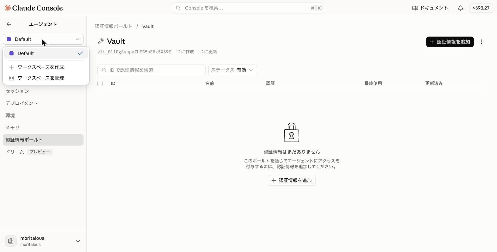

</Aside>

## 5. エディタの準備

中級以降ではコードや設定ファイルを編集します。普段使っているエディタで構いません。特にこだわりがなければ[Visual Studio Code](https://code.visualstudio.com/)をおすすめします。
