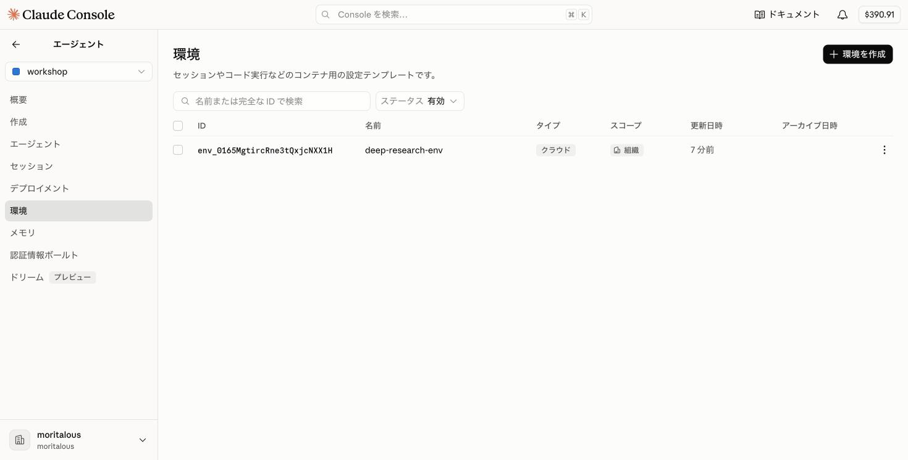
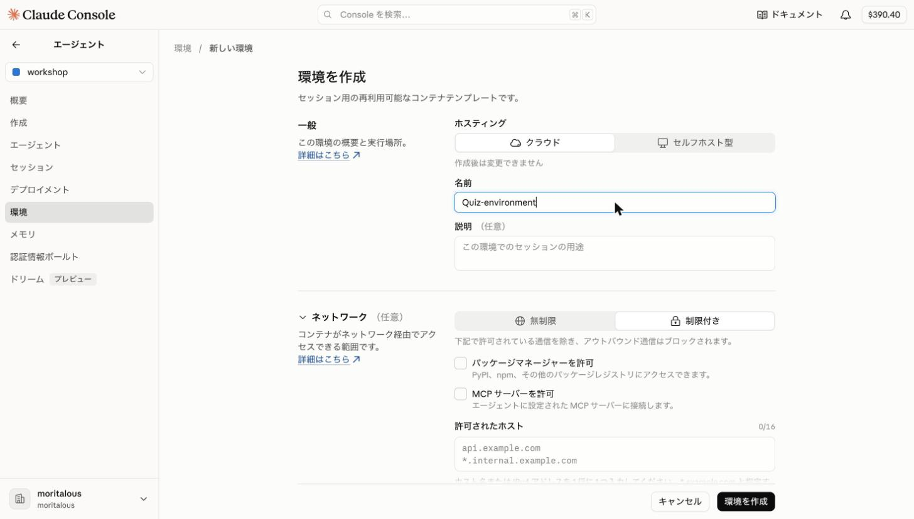
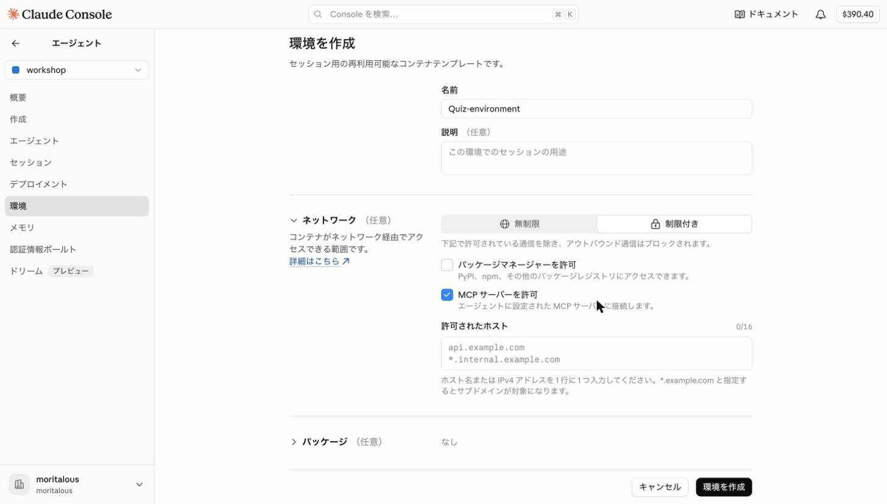
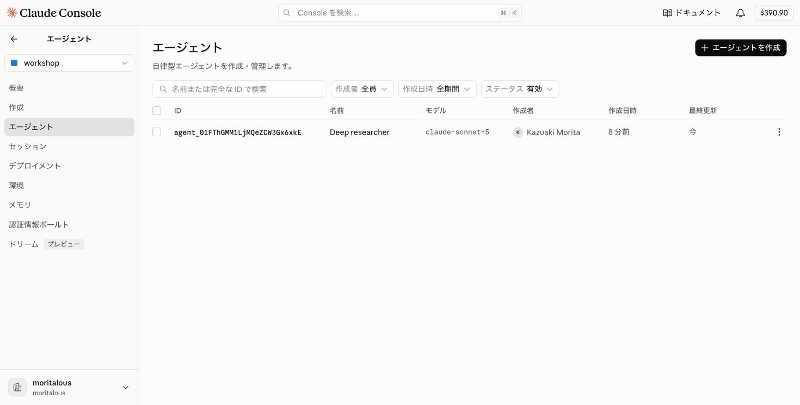
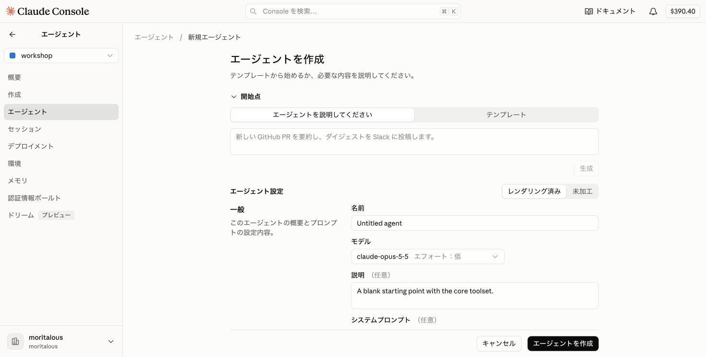
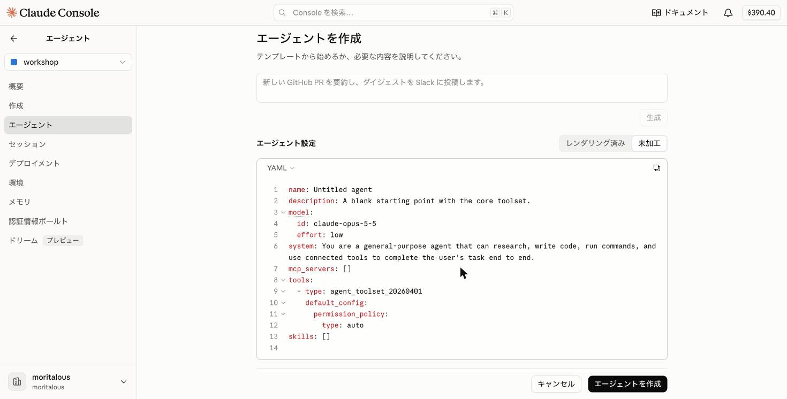
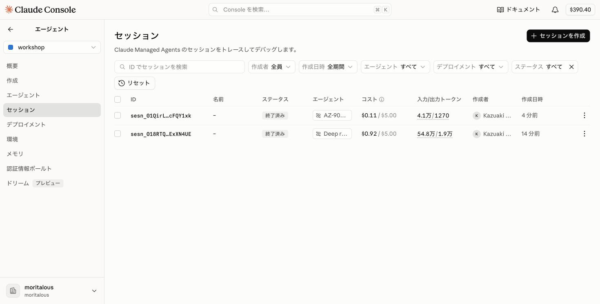
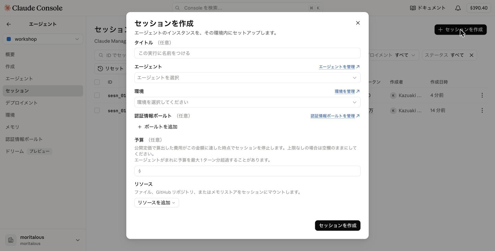
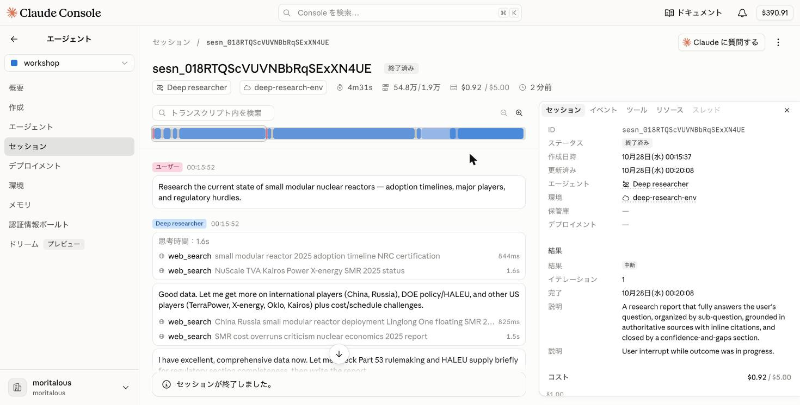

import { Steps, Tabs, TabItem, Aside } from '@astrojs/starlight/components';
import ShareOnX from '../../../components/ShareOnX.astro';

<Aside type="note" title="中級（簡易版）について">
[中級](/intermediate/01_console/)はJina AIのAPIキーを使いますが、無料枠のクォータ制限などでキーが使えないことがあります。この「簡易版」では、**APIキー不要**のMicrosoft Learn MCPサーバーを使って、中級と同じ流れ（コンソール → CLI → SDK）を体験します。作るのは[初級2](/beginner/02_blank/)と同じ**AZ-900練習問題エージェント**です。
</Aside>

このページでは、コードを一切書かずに、コンソールの画面操作だけで**AZ-900練習問題エージェント**を作成します。初級2では「作成」のチャット画面が環境・エージェント・セッションをまとめて作ってくれましたが、ここでは「エージェント」メニューの各サブメニューから、部品をひとつずつ手で作ります。

Microsoft LearnのMCPサーバーは認証不要なので、中級で必要だった**認証情報ボールトは不要**です。作成する要素は次の3つです。

| 要素 | 役割 |
|------|------|
| 環境 | MCPサーバーへのネットワークアクセスを許可する実行環境 |
| エージェント | Microsoft Learnのツールを使って練習問題を出題するエージェント本体 |
| セッション | 環境・エージェントを組み合わせて起動する実行単位 |

## 1. 環境を作成

<Steps>

1. 「エージェント」メニューのサブメニューから「環境」を選択し、「環境を作成」をクリックします。

    

1. ホスティングは「クラウド」のまま、名前に「Quiz-environment」と入力します。

    

1. 下にスクロールして「ネットワーク」を設定します。「制限付き」を選択し、「MCP サーバーを許可」にチェックを入れます。最後に「環境を作成」をクリックします。

    

    <Aside>
    「許可されたホスト」は空のままで構いません。この環境ではMCPサーバー経由でしか外部にアクセスしないため、「MCP サーバーを許可」だけで足ります。
    </Aside>

</Steps>

## 2. エージェントを作成

<Steps>

1. サブメニューの「エージェント」を選択し、「エージェントを作成」をクリックします。

    

1. 「エージェント設定」の右側にある「未加工」をクリックして、YAMLエディタに切り替えます。

    

1. エディタの内容をすべて削除して以下のYAMLに置き換え、「エージェントを作成」をクリックします。

    

    ```yaml
    name: AZ-900 Quiz Agent
    model:
      id: claude-haiku-4-5
      speed: standard
    description: Microsoft Learn MCPサーバーの最新情報を使ってAZ-900（Azure Fundamentals）の練習問題を出題する学習アシスタント。
    system: |-
      あなたはMicrosoft Learn MCPサーバーを使ってAZ-900（Azure Fundamentals）の練習問題を作成する学習アシスタントです。Microsoft Learnの最新の公式ドキュメントを参照し、選択式の問題を1問ずつ出題してください。

      ルール:
      - 問題文と選択肢を提示したら、ユーザーが回答するまで正解を明かさない。
      - ユーザーの回答後、正誤を伝え、各選択肢について正誤のポイントを1行ずつで説明する。
      - 学習の参考になるMicrosoft Learnドキュメントの実在するURLを3つ提示する。
      - 会話内でユーザーの過去の回答（正解・不正解、出題分野）を記憶し、間違えた分野・苦手なトピックを優先的に次の問題として出題する。
      - 一度に1問だけ出題し、テンポよく進める。
    mcp_servers:
      - name: microsoft-learn
        type: url
        url: https://learn.microsoft.com/api/mcp
    tools:
      - type: mcp_toolset
        mcp_server_name: microsoft-learn
        default_config:
          enabled: true
          permission_policy:
            type: always_allow
    skills: []
    metadata: {}
    ```

    <Aside>
    初級2で自動生成された設定とほぼ同じですが、モデルを`claude-haiku-4-5`にしてコストを抑え、ツールはMCPサーバーのものだけ（`mcp_toolset`）に絞っています。`web_search`などのビルトインツール（`agent_toolset_20260401`）は使いません。
    </Aside>

</Steps>

## 3. セッションを作成

<Steps>

1. サブメニューの「セッション」を選択し、「セッションを作成」をクリックします。

    

1. エージェントに「AZ-900 Quiz Agent」、環境に「Quiz-environment」を選択し、「セッションを作成」をクリックします。認証情報ボールトは不要なので、空のままで構いません。

    

</Steps>

## 4. エージェントを呼び出す

<Steps>

1. セッションの詳細ページが開きます。画面下部のチャット欄に「AZ-900の練習問題を1問出題してください」と入力し、送信します。

1. エージェントがMicrosoft LearnのMCPツール（`microsoft_docs_search`）を呼び出し、問題を出題します。右側のインスペクターでは、セッション情報・イベント・ツール呼び出しを確認できます。

    

1. 同じチャット欄で回答（例: `C`）を送ると、正誤判定と解説が返ってきます。

</Steps>

## まとめ

- 認証不要のMCPサーバーなら、**環境・エージェント・セッション**の3つの部品だけでエージェントを動かせます。認証情報ボールトが必要になるのは、APIキーやOAuthが必要なMCPサーバーを使うときです。
- MCPサーバーを使うには、①環境でMCPサーバーへのネットワークアクセス許可（「制限付き」＋「MCP サーバーを許可」）、②エージェントに`mcp_servers`と`mcp_toolset`の定義、の2点が必要です。
- 次のページからは、同じ構成をCLIとSDKで作ります。

<ShareOnX />
