import { Steps, Tabs, TabItem, Aside } from '@astrojs/starlight/components';
import ShareOnX from '../../../components/ShareOnX.astro';

このページでは、コードを一切書かずに、コンソールの画面操作だけで**Webリサーチエージェント**を作成します。外部ツールとの接続にはJina AIのMCPサーバーを使います。

初級では「作成」のチャット画面がエージェント・環境・セッションをまとめて作ってくれましたが、このページでは「エージェント」メニューの各サブメニュー（認証情報ボールト・環境・エージェント・セッション）から、部品をひとつずつ手で作ります。

完成すると、チャットで「最新のRAGに関する論文を検索して」と頼むだけで、エージェントがWeb検索と論文の読み取りを行い、出典付きで回答してくれるようになります。

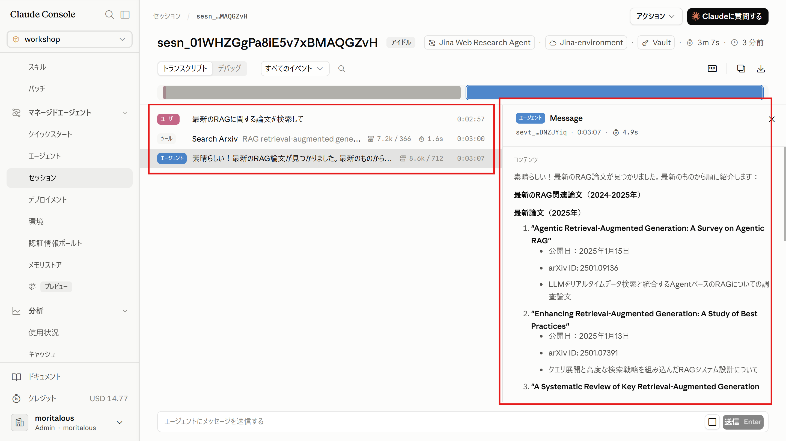

作成する要素は次の4つです。

| 要素 | 役割 |
|------|------|
| 認証情報ボールト | Jina AIのAPIキーを安全に保管する仕組み |
| 環境 | MCPサーバーへのネットワークアクセスを許可する実行環境 |
| エージェント | Jina AIのツールを使うリサーチエージェント本体 |
| セッション | ボールト・環境・エージェントを組み合わせて起動する実行単位 |

## Jina AIとは

[Jina AI](https://jina.ai/)は、Web検索やページ読み取りなど、LLM向けの検索基盤APIを提供しているサービスです。公式のリモートMCPサーバー（`https://mcp.jina.ai/v1`、リポジトリ: [jina-ai/MCP](https://github.com/jina-ai/MCP)）が公開されており、エージェントから次のようなツールを呼び出せます。

- `search_web`・・・Web全体を検索
- `search_arxiv` / `search_ssrn`・・・学術論文を検索
- `read_url`・・・WebページをMarkdownとして読み取り
- `parallel_read_url`・・・複数のURLを並列で読み取り

このほか画像検索やPDF抽出なども含め、約20種類のツールが提供されています。APIキーはクレジットカード登録なしで無料発行でき、無料トークン枠の範囲でこのハンズオンを進められます。

<Aside type="tip" title="Jina AIが使えないときは">
クォータ制限に引っかかってJina AIのMCPサーバーが利用できない場合は、代わりに[Firecrawl](https://www.firecrawl.dev/)のMCPサーバーを使ってください。登録方法とこのページの読み替え方は、[トラブルシューティング：Jina AIがクォータ制限で使えない](/reference/troubleshooting/#jina-aiがクォータ制限で使えない)にまとめています。
</Aside>

## 1. Jina AIのAPIキーを取得

<Steps>
1. https://jina.ai/ にアクセスします。

1. 画面中程までスクロールし、「API KEY & BILLING」タブをクリックします。コピーアイコンをクリックしてAPIキーをコピーします。

    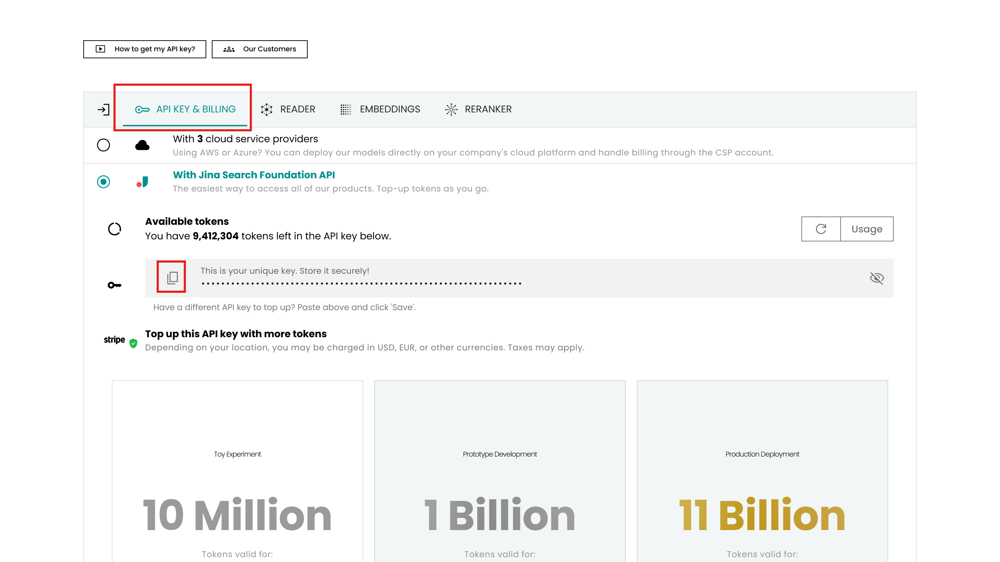

</Steps>

## 2. 認証情報ボールトを作成

まず、認証情報ボールトを作成します。認証情報ボールトとは、外部サービスのAPIキーやトークンといった認証情報を安全に保管しておく仕組みです。セッション作成時にボールトを指定すると、エージェントがMCPサーバーに接続する際にその認証情報が使われます。システムプロンプトや会話にAPIキーを直接書かずに済むのがポイントです。

<Steps>

1. 「エージェント」メニューのサブメニューから「認証情報ボールト」を選択し、「ボールトを作成」をクリックします。

    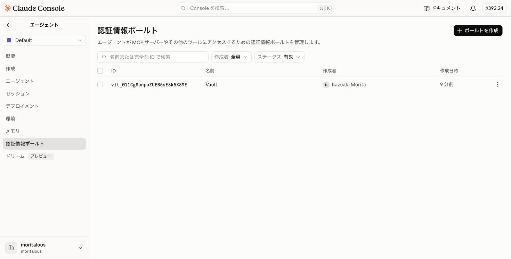

1. ボールトの名前として「Vault」を入力し、「続ける」をクリックします。

    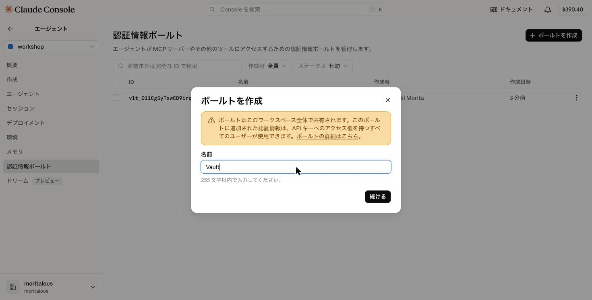

    <Aside type="caution">
    認証情報ボールトは、ワークスペース内で共有されます。
    </Aside>

1. 続けて「認証情報を追加」ダイアログが開きます。名前に「Jina-ai」と入力します。

    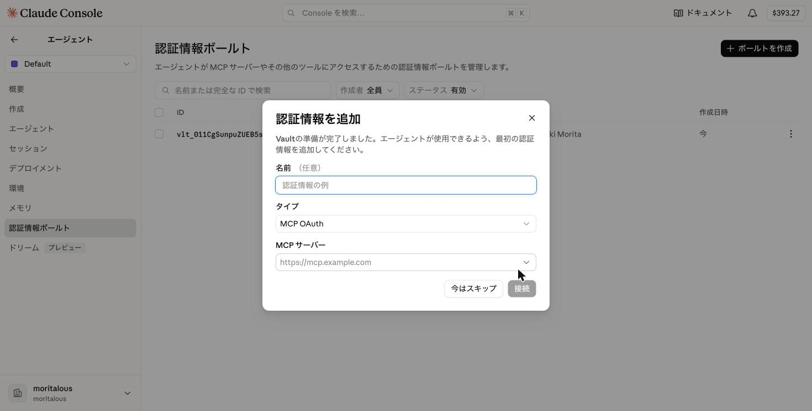

1. タイプは既定で「MCP OAuth」になっているので、「Bearer トークン」に変更します。

    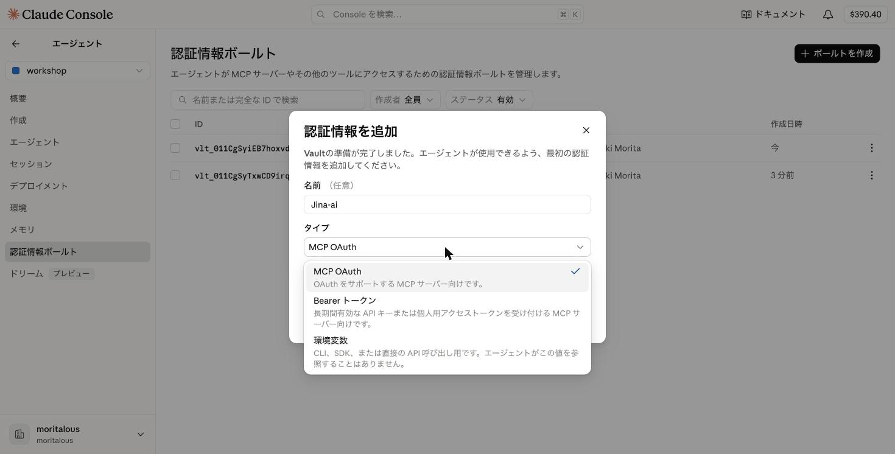

1. 「MCP サーバー」をクリックします。プリセット（Google Drive、Gmail、Notionなど）の一覧が表示されます。

    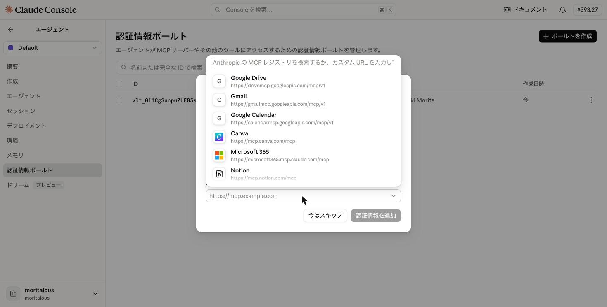

1. ここでは検索欄に「`https://mcp.jina.ai/v1`」と入力し、表示された「カスタムサーバー」をクリックします。

    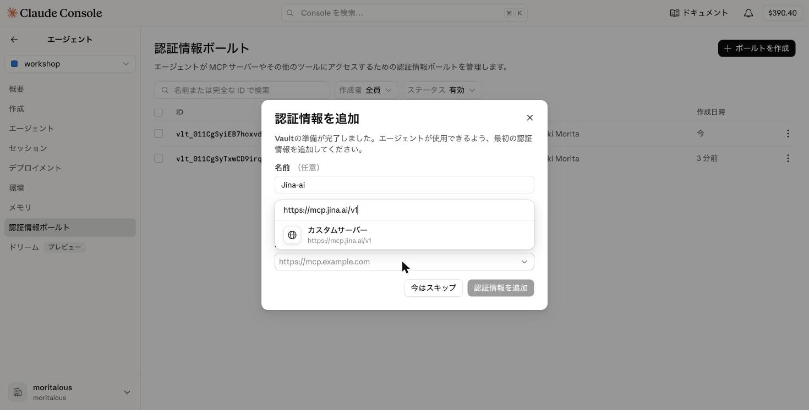

1. 「トークン」にJina AIのAPIキーを入力します。認証情報に関する注意事項に同意（チェック）し、「認証情報を追加」をクリックします。

    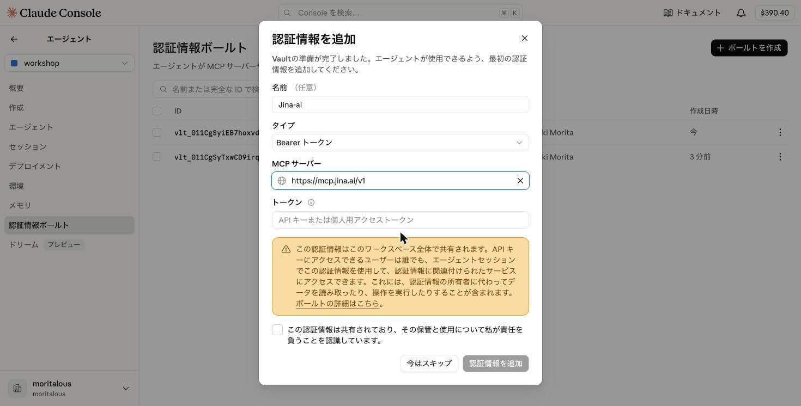

</Steps>

## 3. 環境を作成

<Steps>

1. サブメニューの「環境」を選択し、「環境を作成」をクリックします。

    

1. ホスティングは「クラウド」のまま、名前に「Jina-environment」と入力します。

    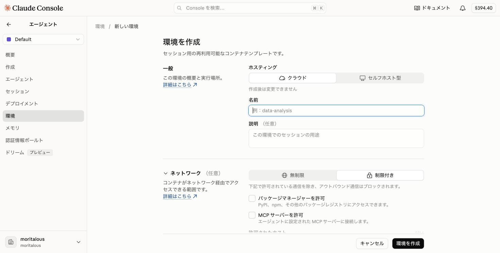

1. 下にスクロールして「ネットワーク」を設定します。「制限付き」を選択し、「MCP サーバーを許可」にチェックを入れます。最後に「環境を作成」をクリックします。

    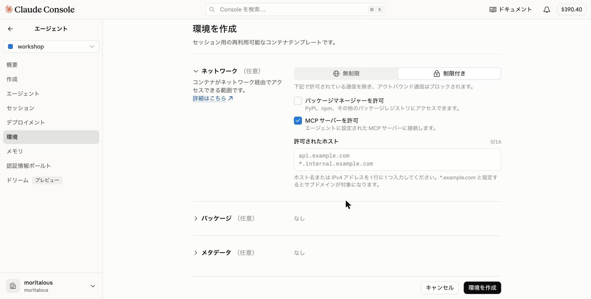

    <Aside>
    初級で作った環境と違い、Web検索用の`web_search`ツールは使わず、MCPサーバー経由でのみ外部にアクセスするため、ネットワークは「制限付き」で十分です。
    </Aside>

</Steps>

## 4. エージェントを作成

<Steps>

1. サブメニューの「エージェント」を選択し、「エージェントを作成」をクリックします。

    

1. 「エージェント設定」の右側にある「未加工」をクリックして、YAMLエディタに切り替えます。

    

1. エディタの内容をすべて削除して以下のYAMLに置き換え、「エージェントを作成」をクリックします。

    

    ```yaml
    name: Jina Web Research Agent
    model:
      id: claude-haiku-4-5
      speed: standard
    description: Jina AIのMCPサーバーを使ったWeb検索、ページ読み取り、学術研究のデモエージェント。
    system: あなたはJina AIの検索・読み取りツールを活用するリサーチアシスタントです。質問を受けたら、search_web（学術的なトピックの場合はsearch_arxivやsearch_ssrn）を使って関連ソースを見つけ、その後read_urlまたはparallel_read_urlを使って、有望な結果の全文を取得してください。検索結果のスニペットだけに頼らないようにしてください。複数のソースから得た情報を組み合わせ、使用したURLを引用し、不確実な点や矛盾する情報がある場合は明確に示してください。効率化のため、複数のソースを同時に検索・読み取る際はparallel_*系のツールを優先して使ってください。特定のページの要約や事実抽出を求められた場合は、read_urlで直接そのページを読み取ってください。回答は簡潔かつ整理された形にし、事前知識ではなく取得したコンテンツに基づくようにしてください。
    mcp_servers:
      - name: jina
        type: url
        url: https://mcp.jina.ai/v1
    tools:
      - configs: []
        default_config:
          enabled: true
          permission_policy:
            type: always_allow
        mcp_server_name: jina
        type: mcp_toolset
    skills: []
    metadata: {}
    ```

    <Aside>
    「開始点」欄に文章を入力して「生成」すると、初級と同じようにYAMLを自動生成することもできます。「レンダリング済み」に戻すと、名前・モデル・システムプロンプトなどをフォームで編集できます。
    </Aside>

</Steps>

## 5. セッションを作成

<Steps>

1. サブメニューの「セッション」を選択し、「セッションを作成」をクリックします。

    

1. エージェントに「Jina Web Research Agent」、環境に「Jina-environment」を選択します。「認証情報ボールト」の「ボールトを追加」をクリックして「Vault」を選択し、「セッションを作成」をクリックします。

    

    <Aside>
    「予算」を入力しておくと、公開定価で算出した費用がその金額に達した時点でセッションが自動停止します。
    </Aside>

</Steps>


## 6. エージェントを呼び出す

<Steps>

1. セッションの詳細ページが開きます。画面下部のチャット欄に「最新のRAGに関する論文を検索して」などを入力し、送信します。

    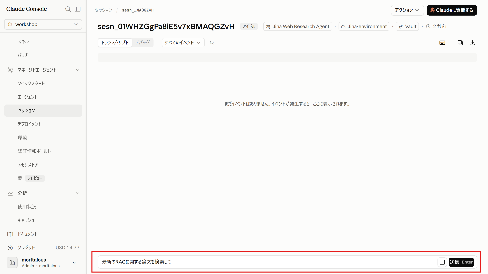

1. MCPサーバーを使って情報を取得し、回答が返ってきます。右側のインスペクターでは、セッション情報・イベント・ツール呼び出しを確認できます。

    

</Steps>

## まとめ

- APIキーのような秘密情報は**認証情報ボールト**に保管し、セッション作成時に紐付けます。システムプロンプトや会話にキーを書かずに済みます。
- MCPサーバーを使うには、①ボールトに認証情報(接続先URL単位)、②環境でMCPサーバーへのネットワークアクセス許可（「制限付き」＋「MCP サーバーを許可」）、③エージェントに`mcp_servers`と`mcp_toolset`の定義、の3点が必要です。
- **環境・エージェント・セッション（必要な場合はボールト）**という部品の組み立てが、Managed Agentsの基本形です。次のページからは、同じ構成をCLIとSDKで作ります。

<ShareOnX />
